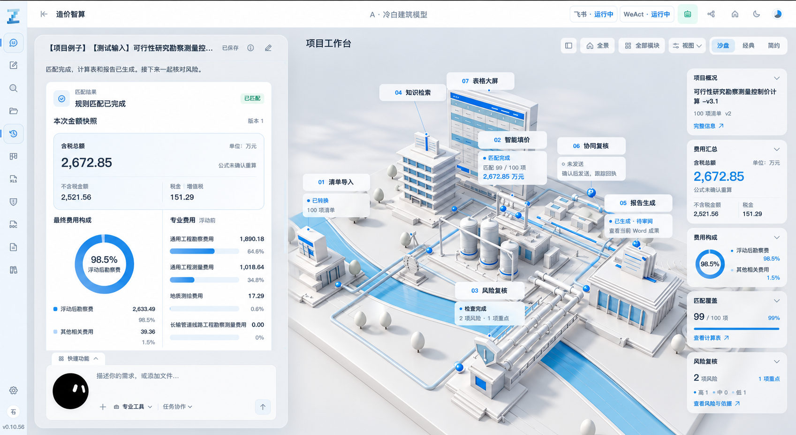
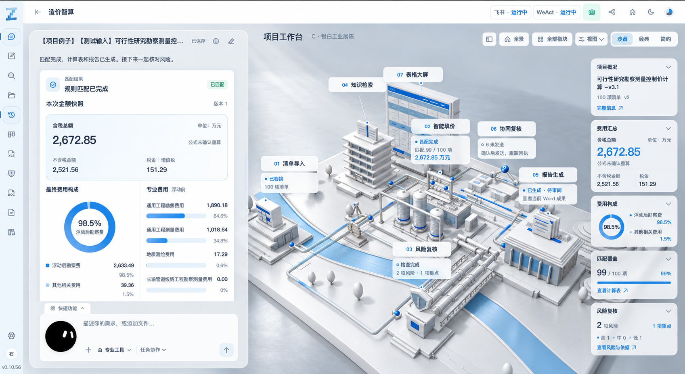

# 视觉规格：A 的整体光感，C 的局部表面

## 1. 参考图的使用规则

优先级固定为：**当前真实产品与业务 > A 整体 > C 局部 > 历史原截图**。

A/C 都是生成的设计参考。它们重绘了局部建筑、比例、标签和文字；本次提取光照与材质关系，几何和业务信息由当前代码决定。图中的 “A / C” 方案标题、金额、百分比、版本号不进入产品。

### A：整体目标

需要提取：明亮冷白、清楚的顶面/侧面层次、柔和但可辨的投影、哑光建筑模型、浅蓝强调、轻盈但落地的实体感。

### C：仅参考管罐与连接件

需要提取：圆柱与弯管连续的高光带、储罐的曲面明暗、连接件清楚的边缘。主方案以白色涂层实现这种表面区分，极少量裸银连接件可选。

**不要提取 C 的镜面地面、大片反射、云状背景光斑和整体更灰的氛围。** 不把全园区变成钢铁，不新增车、人、树、复杂纹理来填满画面。

历史原图在 [00-original-context.png](assets/00-original-context.png)。它不等于 v0.10.56 当前实机状态，Codex 必须另外采集 before。

## 2. 各部分应呈现什么

| 部分 | 明度/表面关系 | 通过时可见的结果 | 失败表现 |
| --- | --- | --- | --- |
| 建筑墙面、楼板、屋顶 | 冷中性白，哑光或细腻缎面 | 顶面明亮、背面冷灰白、楼板下稍暗，边角清楚 | 纯白糊成一片、脏灰墙、大片油光 |
| 储罐 | 白色涂层，更光滑 | 连续高光带随视角变化，圆柱弧面与罐脚落地可读 | 二维白条、全黑镜面、过曝亮线 |
| 前景管桥、厂内管线 | 浅银白观感，管壁比建筑细腻 | 弯头、法兰与长向反光清楚，原粗细和走向保留 | 整条白光、粗细改变、误把墙面染为金属 |
| 地台、底座 | 比主体略冷灰，以哑光为主 | 主体落在地台上，边缘与背景分离 | 大面积倒影、阴影脏圈、漂浮 |
| 外围背景 | 安静、低对比，服从原地面偏好 | 不抢主体，不与 UI 产生突兀边界 | 天空贴图、光斑、云朵、大幅色温变化 |
| 蓝色窗面/面板 | 保留原蓝色语义，少量表面响应 | 白墙与窗面区分，仍看得见楼体轮廓 | 整栋变成发光玻璃体、蓝色泛光覆盖白面 |
| 水道 | 轻柔浅蓝，低对比 | 辅助分隔场地与衬托管桥 | 亮海水、强波纹、大倒影抢主体 |
| 业务节点、选中与流线 | 现有业务蓝与真实状态 | 仍可辨当前焦点与任务流程 | 所有节点常亮、状态失真、无意义霓虹 |

白色层次来自光照、表面粗糙度、微法线和几何转折共同作用，不靠额外染灰每一面来画死阴影。局部变化应随真实相机和光照合理变化。

## 3. 相机、界面与业务边界

默认镜头、投影类型、模型位置和缩放规则遵循当前产品。近景使用现有聚焦/旋转/缩放能力。不得重排模块、移动罐体、增厚楼板或抬高地台来追逐生成图构图。

主验收图中聊天、右侧业务卡片和七个真实模块入口正常显示。额外隐藏标签的诊断图可以辅助看材质，但不能替代产品验收图。不要缩小字体、裁掉卡片或换成静态图。

模型颜色不能改变价格、匹配、风险、报告和派发含义。图中显示何种任务/数据，以真实当前测试状态为准。表格楼是否只显示标题、状态卡何时展开，遵循现有逻辑。

不开全页面模糊、调色滤镜或景深。UI 清晰度和 3D 光照独立；不让 3D 色调映射改变真实业务文字。

## 4. 可直接逐项打分的视觉检查

| ID | 检查对象 | 通过条件 | 典型失败 |
| --- | --- | --- | --- |
| V01 | 默认全景 | 整体明亮白蓝；主体、地台、背景分层，接近 A | 仍是一片灰白或变成深色/暖橙风格 |
| V02 | 多层楼板 | 顶面、立面、楼板下方有三个可读层次 | 楼层黏在一起或缝隙黑脏 |
| V03 | 中央储罐 | 圆柱曲面高光连续，罐脚接触地面 | 扁平、过曝、黑镜面或悬浮 |
| V04 | 管桥/弯管 | 比建筑更细腻，弯头/法兰清楚且走向不变 | 亮线吞细节、误染墙面或管线改排 |
| V05 | 地台/底座 | 哑光承托、接触影清楚、与背景分离 | 整栋倒影、黑色脏圈 |
| V06 | 水道 | 浅蓝低对比、辅助分隔空间 | 大片闪光、饱和艳蓝抢主体 |
| V07 | 主光/阴影 | 方向一致，柔边可见，装配与旋转时稳定 | 条纹、跳影、漂浮、反向强影 |
| V08 | 聚焦状态 | 原辉光能标识当前焦点，白色形体仍清楚 | 目标糊成白团、光圈错位、关闭原功能 |
| V09 | UI/业务 | 实时数据与模块正确，卡片可交互、文字清楚 | 复制图中数字、静态贴图、遮挡被隐藏 |
| V10 | 运动与切换 | 拖动/缩放/快速切楼后无闪烁和残留 | 静止好看，一动就错位或跳反射 |
| V11 | 增强关闭/资源回退 | 基础画面恢复、数据入口和交互完整 | 缺材质、黑屏、遗留金属度或法线 |
| V12 | 偏好恢复 | 开关/冷白/地面/相机等原保存逻辑仍有效 | 清空偏好或只在临时开发模式好看 |

视觉检查没有“安装了某依赖就通过”这一判定。每项应关联实际截图、操作记录或测量；参数值仅是实现手段。

## 5. 固定条件与证据

**主视觉状态：** 在隔离样例或可恢复的测试设置中使用日间、增强开启、冷白、未聚焦、现有全景，正常显示七个业务入口。V01—V07 在这一状态下判断 A 的整体方向；V08 在相同基础设置下聚焦。其他合法偏好组合验功能和恢复，不要求夜航、暖白或增强关闭也呈现 A。不得覆盖用户原持久化设置，测试后恢复；截图前的临时设置写进报告。

主验收建议 **1920×1080 CSS 视口，浏览器缩放100%**；布局检查 **1440×900 CSS 视口**。真实环境无法设置该尺寸时，使用可获得的实际尺寸并如实注明，同条件比较，不能把物理截图像素当 CSS 视口。

before/after 保持设备、浏览器、DPR及renderer上限、相机/target、项目快照、开关、任务状态、染色浓度、卡片展开状态一致。使用保存的真实 camera/target 和现有确定视角，不靠手感凑相近机位。

等待资源、装配、相机和渐变稳定后截图。验收图不是开场过程中的某一偶然帧。

| 文件名建议 | 内容 |
| --- | --- |
| `01-before-overview.png` | 修改前当前版本全景，正常 UI |
| `02-after-overview.png` | 修改后，同条件全景 |
| `03-after-tank-detail.png` | 现有聚焦/相机操作取得的储罐近景 |
| `04-after-pipe-detail.png` | 管桥和弯管近景；若一张图确实清楚覆盖管罐，可与上一项合并 |
| `05-after-focus.png` | 原有聚焦辉光开启的真实焦点 |
| `06-after-compact.png` | 小窗口布局与裁切 |
| `07-after-fallback.png`（条件项） | 改动模型/资源加载时提供回退状态关键帧 |

近景要标明“近景机位”，不能与全景 before 并排称同条件。两张 A/C 概念图不计入实机证据。

另交 15—25 秒操作录屏，或真实操作日志与关键帧：全景→旋转/缩放→聚焦→切换另一区→返回全景；检查一次光影开关与刷新恢复。性能采样可与录屏分开，避免录屏开销影响判断。

## 6. 视觉迭代如何收口

首次完整实现后，优先做三轮有归因的调整：整体光照、材料差异、状态/性能收口。每轮记录“问题—改动—同机位对照—结果”，保留较好的可用版本。

同一区域连续两轮无可辨提升，先查曝光压缩、环境高光方向、角色映射、法线/UV、阴影范围和状态覆盖顺序。不要随机增加特效，也不为另一张更好看的角度重新定义目标。硬性失败仍须修复；缺少环境或无法匹配的部件如实列为未完成，不能用迭代次数掩盖。

