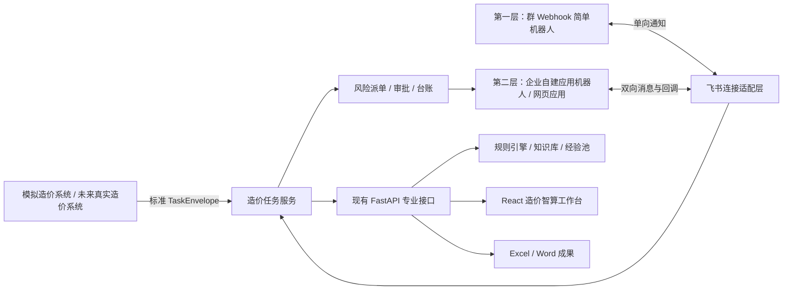

# 智能协同 PRD

## 模块目标

“智能协同”是造价智算连接飞书 / WeAct、上游造价系统和组织人员的协同与流程功能页。它把飞书 / WeAct 作为任务主动触达层，把现有造价智算作为规则计算、专业复核、知识检索和成果生成引擎，使上游系统产生的任务、任务单和待填写表格能够主动找到编制人，再经过材料提交、规则处理、风险复核、成果审批和交付归档形成闭环。

本模块不是把现有造价智算全部重做在飞书里，也不是让飞书机器人或大模型直接裁决价格。飞书负责连接人员、消息、任务、文件、审批和提醒；现有 FastAPI、React、结构化计价库、规则表、经验池和 Word / Excel 处理能力继续承担专业业务逻辑。

## 优先级

当前基础连接能力已经完成；下一阶段“场景化协同编审”按模块内部 **P0 / P1 / P2** 分阶段建设。这里的 P0 / P1 / P2 表示本模块内部实施顺序，不替代项目总版本计划中的全局优先级。

对外模块名：**智能协同**。

页面位置：造价智算左侧一级功能菜单，固定排列在“知识库问答”下方。

历史接入阶段按两层顺序建设：第一层先做只能向指定群推送消息的 Webhook 简单机器人，第二层再建设企业自建应用形态的复杂全功能机器人。两层基础能力已经形成，后续不再以增加通用聊天指令为主，而是围绕“编制—多人复核—可选审批—成果发布”建设具体业务场景。

场景化路线坚持“简单流程优先、复杂流程可选”：普通任务可以只走“编制—多人复核—完成”，需要正式审批的任务再走“编制—多人复核—审批—发布”。

## 产品定位

### 一句话定位

> 飞书里的工程造价任务入口、协同助手和流程管家。

## 场景化协同编审路线（P0 / P1 / P2）

本阶段聚焦一个完整场景：外部造价系统把勘察测量最高投标限价任务和待填写表格主动派给编制人，编制人完成网页编制后，再经多人复核、可选审批和成果发布形成闭环。当前先由“智能协同”页面模拟外部造价系统信号，在授权群聊中完成任务卡和待填 Excel 的主动投递；数据结构同时保留按平台用户 ID 精准单聊的能力。造价智算网页是任务、版本、专业结果和审核状态的唯一业务真相；WeAct / 飞书负责人员触达、提醒、安全跳转和经验证后的轻量操作。

流程不强制一律复杂化。用户提交复核时选择流程模板，流程启动后绑定当前成果版本；如需改变流程，应先撤回当前轮次并重新提交，避免同一版本在不同规则下并行流转。

| 模块优先级 | 流程模板 | 核心目标 | 主要范围 | 阶段验收 |
| --- | --- | --- | --- | --- |
| P0-A | 外部任务主动派发模拟 | 先验证“任务和文件主动找人” | “智能协同”模拟外部造价系统产生标准任务信号；创建内部任务和任务专用待填表；通过第二层应用机器人向授权群发送经典任务卡和 Excel；卡片明确目标编制人；同时保留按平台用户 ID 单聊投递的统一接口和数据字段 | 同一外部任务信号重复提交不重复建任务；授权群收到同一任务编号的卡片和 Excel；投递状态、目标人、文件版本和失败原因可追溯；精准单聊在身份或权限不足时明确拒绝而非猜测 |
| P0-B | 简易多人复核 | 跑通最常用、最轻量的编审闭环 | `编制 → 并行多人复核 → 复核完成`；网页提交并冻结成果版本；选择一名或多名复核人；WeAct 通知和安全跳转；网页通过 / 退回；结构化收集、汇总和闭环多人复核意见 | 至少一项真实试点任务完成“提交—多人复核—意见汇总—通过或退回—重新提交”；所有指定复核人通过后结束，任一人退回则本轮退回；WeAct 不可用不影响网页处理 |
| P1 | 标准编审流程 | 在简易流程上增加风险派单和可选审批 | `编制 → 多人复核 → 审批 → 发布`；按风险项派单；截止时间、催办、转交；验证 WeAct 原生审批或卡片回调；正式成果发布和归档 | 高风险未关闭时按规则阻止或警示提交；审批通过、退回、撤回均正确同步；直接 WeAct 操作只有在身份、权限、版本和幂等验证通过后启用 |
| P2 | 智能化编审与管理 | 让系统理解材料、风险、人员和历史处理结果 | 材料完整性检查、复核人推荐、风险驱动流程推荐、一页式审核摘要、版本差异、退回意见转待办、多维表格管理镜像、统计分析和知识候选闭环 | 智能建议可解释、可人工覆盖；台账与内部状态可对账；人工结果只进入候选池，不自动写入正式知识库、规则表或经验池 |

### P0 默认规则

- P0 先建设“外部任务主动派发模拟”，再衔接编制和多人复核；它属于“智能协同”同一任务生命周期，不新建第二个模块 PRD。
- 当前真实演示默认投递到已授权试点群。企业 WeAct 仍只允许唯一“智算测试”；普通飞书不设置固定群名白名单，但只能投递到用户本次从平台目录中明确选择、成员可核验且不超过 10 人的工作群。未明确选择或成员校验失败时不得发送。
- 待填写 Excel 必须由模板生成任务专用副本，任务记录保存来源系统、外部任务编号、模板版本和文件哈希；不得把公共母版作为可修改附件直接发送。
- 群聊模拟也必须记录目标编制人和复核人的平台用户 ID；群消息中可以显示并提醒对应人员。后端按阶段支持 `group`、`direct` 或双通道，精准单聊只有在用户映射、权限和主动消息能力验证通过后才能启用。
- 任务卡和 Excel 必须使用同一内部任务编号；投递失败只进入可重试状态，不删除任务、不重复生成文件，也不改变专业计算结论。
- 默认采用“并行多人复核”，不要求设置审批人。
- 网页填价完成后可以从成果下载区或智算对话发起复核：智算对话不得直接发送或跳转独立设置页，必须先在当前消息流中展开发送前设置卡；飞书与 WeAct 分别使用可折叠平台面板和独立人员配置，可同时勾选两个平台，每个平台的个人私聊 / 工作群也可用复选框同时启用；用户须逐一勾选复核人并再次确认受众范围，“补充复核要求”默认折叠。前端只提交当前网页任务编号和上述明确选择，后端必须按“成果 + 平台”分别建立幂等复核任务、从任务运行目录读取真实输出 Excel 并冻结哈希快照，不接受浏览器传入任意本机路径或替换文件。
- 编制人提交时生成不可修改的成果快照，例如 `V1`，至少关联 Excel、Word、风险摘要、编制人和提交时间。
- 所有指定复核人均通过后，任务进入“复核完成”；任一复核人退回后，本轮立即进入“退回修改”，已提交意见继续保留。
- 编制人修改后生成 `V2` 重新提交，不覆盖 `V1`，不允许在审核中的冻结版本上直接改值。
- 每名复核人的结论和意见独立保存，至少记录复核人、成果版本、复核轮次、意见范围、意见内容、结论和提交时间；不得用后一人的意见覆盖前一人的记录。
- 复核意见可以面向整项成果，也可以定位到文件、Sheet、行或具体风险项；“退回”必须填写原因，“通过”允许填写补充建议。
- 编制人可以逐条回复并标记“已采纳、部分采纳、不采纳并说明、待确认”，但不能删除或修改复核人原始意见。
- 系统形成“多人复核意见汇总”，按复核人、位置、意见等级和处理状态查看；相互冲突的意见必须显式标记，由编制人或指定牵头复核人处理，不交给大模型自动裁决。
- P0 的 WeAct 卡片默认只展示任务摘要、待办状态和“进入审核”安全链接；通过、退回先在网页完成。
- 简易流程结束后的成果标记为“复核完成版”，不伪装成经过审批的“正式审批发布版”。

### P1 直接操作启用条件

- 必须先实测企业 WeAct 对经典卡片回调或原生审批接口的实际支持情况和权限范围。
- 回调必须校验当前用户、任务权限、成果版本、流程节点和动作幂等；旧卡片不得改变新版本或已发布任务。
- 不满足直接操作条件时继续使用“卡片通知 + 安全链接进入网页处理”，不得提供看似可用但没有可靠服务端闭环的按钮。
- 通过、退回和审批均不得反向修改结构化计价库、匹配规则、价格、系数或风险等级。

## P0：外部造价任务主动派发模拟

### 功能定位

本能力是“智能协同”的上游任务接入子场景，不需要重新建立独立 PRD。当前用一个受控模拟器代替尚未接入的真实造价系统，模拟器和未来真实系统必须产生相同的标准任务信号；未来接入时只替换来源适配器，不重写任务创建、文件版本、人员路由、消息投递和状态跟踪。

产品表达：

> 过去是经办人登录系统寻找任务和模板；现在是上游造价业务一产生任务，任务要求、专业 Skill 和待填写表格就主动找到经办人。

### 标准任务信号

建议内部统一使用 `TaskEnvelope`，至少包含：

```json
{
  "event_id": "evt-20260722-001",
  "event_type": "task.assigned",
  "source_system": "模拟造价系统",
  "source_task_id": "ZJ-2026-001",
  "task_name": "某项目勘察测量最高投标限价编制",
  "skill_id": "survey-measurement-limit-price",
  "delivery_mode": "group",
  "target_chat_id": "受控群聊标识",
  "assignee_user_id": "目标编制人平台用户ID",
  "deadline": "2026-07-25T17:00:00+08:00",
  "instructions": "请根据附件完成最高投标限价编制",
  "input_artifact": {
    "template_asset_id": "待填写表格模板标识",
    "template_version": "v1.0"
  }
}
```

约束：

- `source_system + source_task_id + event_type` 作为业务幂等键，重复信号不得重复建任务或重复发文件。
- `skill_id` 必须来自真实 Skill Registry；规划中或停用 Skill 不得创建可执行任务。
- `assignee_user_id` 是人员责任和未来精准单聊依据，姓名只用于显示，不能作为唯一身份。
- 群聊和单聊共用同一个投递服务；任务卡、待填 Excel、复核卡和完成／退回通知分别配置群聊、个人或双通道，差异只体现在目标解析和平台发送参数，不复制多套任务逻辑。
- 未来真实造价系统可以通过受控 API、Webhook 或消息队列提交同一信号结构，但必须增加来源认证、签名、重放防护和调用限流。

### “智能协同”页面模拟器

页面增加“外部任务接入模拟”区域，不新增左侧一级菜单。至少提供：

- 来源系统，P0 固定显示“模拟造价系统”。
- 外部任务编号、任务名称、项目名称、截止时间和任务说明。
- 专业能力选择，只允许选择真实 `active` Skill。
- 待填写 Excel 模板选择或上传；原始模板只读，派发时生成任务专用副本。
- 投递平台、成员来源群、人员选择范围、目标编制人和多人复核人。
- 按阶段投递策略：任务卡、待填 Excel、复核卡、完成／退回通知均可独立选择工作群、个人或同时发送；提供“混合模式（推荐）”“全部群内协作”“全部个人私聊”和“自定义”快捷方案。
- “创建并推送”主动作，以及投递状态、失败原因、重试和操作记录。

模拟器是管理员 / 演示能力，不提供任意文本、任意群或任意文件转发接口。目标群必须来自受控配置，目标人员必须来自已验证用户映射。

### P0 群聊投递方式

由于 Webhook 简单机器人不能上传文件、不能识别用户和完成精准派单，P0 的“任务卡＋待填写 Excel”群聊模拟应复用第二层企业应用机器人已有的文件上传与经典卡片发送能力，而不是扩张第一层 Webhook。

投递顺序：

```text
接收并校验 TaskEnvelope
→ 生成内部任务编号
→ 基于只读模板生成任务专用 Excel 副本
→ 保存任务、目标人、模板版本和文件哈希
→ 向授权群发送经典任务卡
→ 发送同一任务编号的 Excel 文件
→ 记录卡片消息、文件消息和投递结果
```

经典任务卡至少显示：任务名称、内部 / 外部任务编号、来源系统、目标编制人、截止时间、专业能力和任务说明。P0 卡片按钮只允许安全跳转到造价智算任务或智算助手，不直接批准、修改或完成任务。

### 精准找到用户的能力

P0 即使先在群聊模拟，技术模型也必须具备按人路由能力：

- 建立 `employee_id / account → feishu_user_id / weact_user_id → display_name → enabled` 的受控映射。
- 任务始终保存目标编制人的稳定平台用户 ID，群聊消息尽可能使用真实平台 ID 提醒目标人。
- 投递服务兼容 `delivery_mode=group|direct|mixed`，并以 `delivery_policy` 保存每个阶段的实际通道；群聊与单聊共用任务、文件、卡片生成和审计逻辑。
- 个人接收人按阶段确定：任务卡和待填 Excel 发编制人，复核卡发全部复核人，完成／退回通知发编制人及全部复核人；同一阶段的同一人员只发送一次。
- 精准单聊启用前，必须用企业应用 A 实测主动触达权限和目标用户可达范围；“已经验证机器人能处理单聊”不等于“已经验证可主动联系任意用户”。
- 无用户映射、用户停用、权限不足或主动触达失败时，任务进入明确的“待重新指派 / 投递失败”状态，不按姓名猜人，不自动扩大到其他群。

### 用户领取与提交

- P0 用户通过任务卡安全链接进入造价智算 / 智算助手，系统自动带入任务编号、专业 Skill 和任务专用待填表。
- 编制人领取后点击卡片“提交成果并进入复核”，系统为当前任务、当前编制人和当前会话开启 1 分钟受控收件窗口；编制人直接发送完成后的单个 `.xlsx`，机器人将成果绑定当前任务，并把同一成果文件和多人复核卡按投递策略发送给所有复核人。
- 卡片回调必须先完成本地状态校验和写入并立即应答；成果投递、完成和退回通知在后台执行，网络发送失败写入任务投递状态，不能让已经成功的卡片操作因平台等待超时而显示失败。
- 收件继续复用平台时间校验、15 分钟延迟补偿和事件 / 消息双重幂等规则。
- 返回文件必须校验任务、提交人、文件类型、任务状态和当前版本；不以相似文件名猜测任务。
- 完成后的专业处理继续调用现有 FastAPI 和规则引擎，机器人不得复制匹配逻辑。

## 页面定位与信息架构

“智能协同”是造价智算主界面中的独立一级功能页，不只是藏在设置中的飞书连接开关。用户点击左侧“智能协同”后，中间工作区切换到协同任务页，右侧“问问智算”仍作为随行助手保留。

左侧一级功能菜单顺序为：

`填价工作台 → 结果预览 → 经验池预警 → 工作量抓取 → 报告生成和预览 → 知识库问答 → 智能协同`

场景化协同页面至少包含：

- 页面标题和飞书连接状态，并明确显示“Webhook 简单机器人”或“全功能机器人”层级。
- “外部任务接入模拟”区域：生成标准任务信号、选择真实 Skill、待填表、授权群和目标编制人，并显示投递记录。
- “新建协同任务”主动作。
- 我的任务 / 待我复核 / 待我审批等轻量筛选。
- 任务列表：任务名称、任务编号、场景、状态、负责人、更新时间、待复核数和截止时间。
- 当前任务详情：材料版本、处理进度、风险摘要、复核状态、审批状态和成果入口。
- 进入专业工作台、发送飞书提醒、重新同步和查看操作记录等动作。
- 未配置飞书时的清晰空态和配置指引；未配置状态不得影响本地填价、预警、问答和成果输出。

“智能协同”页面只承载任务与组织协同信息。需要逐行查看、编辑 Excel 或选择价格 / 系数候选时，继续进入结果预览和辅助填价弹窗，不在协同页面复制专业表格工作台。

### 角色分工

| 层级 | 主要职责 | 不承担的职责 |
| --- | --- | --- |
| 飞书协同层 | 任务发起、人员识别、材料收取、状态通知、复核派单、审批和成果触达 | 不执行价格和系数裁决，不承载复杂 Excel 编辑 |
| 造价任务层 | 维护任务编号、状态、输入版本、运行记录、风险、复核意见和成果关系 | 不改变底层专业规则 |
| 造价智算专业引擎 | Excel 读取、三数字匹配、经验池预警、风险清单、知识问答、Word / Excel 输出 | 不自行批准成果，不替代人工复核 |
| 大模型解释层 | 材料摘要、依据解释、风险说明、通知文案和意见草稿 | 不生成最终单价、系数、审减金额或正式审批结论 |

## 目标用户与角色

| 角色 | 主要动作 | 权限边界 |
| --- | --- | --- |
| 任务发起人 | 新建任务、上传材料、查看本人任务状态 | 默认只能查看本人发起或被授权的任务 |
| 编制人 | 检查材料、执行匹配、处理待复核项、生成成果 | 可修改输出副本，不得直接修改正式规则资产 |
| 复核人 | 接收风险任务、查看依据、确认、修改、挂起或退回 | 不得绕过留痕直接发布成果 |
| 审批人 | 审批成果发布或退回修改 | 审批结论不反向改写专业规则和计算结果 |
| 规则维护人 | 处理知识候选、规则缺口和标准出处问题 | 规则变更必须独立审批并运行回归测试 |
| 管理者 | 查看任务进度、风险分布和闭环情况 | 默认不查看无业务必要的逐行敏感价格数据 |
| 系统管理员 | 配置飞书应用、权限、身份映射和运行环境 | 不拥有业务结果的专业审批权 |

## 两层建设方案

### 第一层：Webhook 简单机器人

第一层采用飞书群自定义机器人 Webhook，只负责从造价智算向一个指定群聊推送通知。

第一层能力：

- 在“智能协同”页面配置或检查 Webhook 连接状态，并发送测试消息。
- 造价智算开始读取、批量匹配、运行预警、生成报告、处理失败或任务完成时，向指定群推送文本、富文本或卡片通知。
- 完成通知展示任务名称、处理状态、匹配 / 风险摘要和“进入造价智算”链接。
- 支持自定义关键词、IP 白名单或签名校验等安全设置；Webhook 地址和签名密钥只保存在后端受控配置中。
- 推送失败时记录错误并允许重试，不影响本地专业主流程。

第一层明确不具备：

- 不能响应用户在群里 @ 机器人的消息。
- 不能从飞书接收标准 Excel、附件和用户输入。
- 不能主动读取群成员、组织用户和用户权限。
- 自定义机器人发送的卡片按钮只能跳转链接，不能通过按钮回调直接修改任务或业务数据。
- 不能发起飞书审批、维护多维表格任务台账或完成按用户派单。

因此，第一层的任务仍由用户在造价智算“智能协同”页或现有专业工作台中创建和处理，Webhook 机器人只是通知出口。

### 第二层：复杂全功能机器人

第二层升级为企业自建应用机器人和网页应用，接入用户身份、消息事件、文件、交互卡片、审批、多维表格和任务协同。普通飞书与企业 WeAct 由两个独立长连接运行器分别接收消息、文件和卡片回调；两侧共用任务库、专业处理能力和一个全局单任务顺序队列，但任务一经创建即绑定平台，后续收件、查询、成果重发与卡片回调不得跨平台处理。

第二层能力：

- 用户在机器人单聊、指定群聊或飞书网页应用中创建造价任务。
- 从飞书接收标准 Excel 和必要附件，生成任务编号并关联后端 job。
- 识别任务发起人、编制人、复核人和审批人，按权限展示任务。
- 实时推送处理阶段，并支持交互卡片、风险派单、复核提醒和任务状态同步。
- 通过安全链接进入对应任务的专业工作台，完成复杂表格复核。
- 接入多维表格任务台账、成果发布审批、正式成果发送和归档。
- 任务归档后只生成知识 / 经验候选，未经治理和审批不得自动写入正式资产。

## 需求清单

| 状态 | 需求 | 说明 | 验收口径 |
| --- | --- | --- | --- |
| [已完成] | Webhook 通知与智能协同页 | 第一层完成多 Webhook 配置、任务阶段通知、完成摘要和工作台跳转 | 只能单向通知；秘密不下发前端；发送失败不影响专业主流程 |
| [已完成] | 第二层收件、建任务与自动处理 | 企业应用机器人通过长连接接收受控消息和标准 Excel，顺序调用现有专业接口并回传 Excel、Word 和风险摘要 | 事件与消息双重幂等；过期事件受控拦截；不复制匹配逻辑；映射不可靠时停止而不猜测 |
| [已完成] | 第二层问答、任务查询与成果触达 | 支持知识库问答、普通问答、群成员查询、任务进度 / 风险查询、成果重发和经典完成卡片；`#知识库` 的正文、分点和表格统一使用蓝色知识卡片，普通飞书表格使用原生表格组件，企业 WeAct 使用兼容经典卡片；普通大模型回答仅在含 Markdown 表格时转卡片 | 查询按会话隔离；卡片失败自动降级为原文字或移动端分组清单；转换只改变展示格式，不改变原答案、依据或网页端 Markdown 表格；成果重发不重新计算、不改变任务状态 |
| [已完成] | 第二层双平台独立连接、身份与运行安全 | 普通飞书 / 企业 WeAct 使用两个独立运行器和两套启停状态，不再通过下拉框互相替换；页面提供两个独立开关，右上角以蓝色小标签持续显示两平台状态；任务、收件窗口、会话查询、成果重发和卡片回调均带 `platform_profile_id`；两侧继续共用一个全局单任务顺序队列、预期身份校验、云端端口覆盖、部署检查和统一只读控制台 | 两平台可以同时在线但专业任务严格顺序处理；任一平台关闭或异常不影响另一平台；任务不能被另一平台同名会话读取或回调；同一平台 App ID 在本地与云端仍只允许一个实例在线；身份不一致拒绝启动；卡片处理异常必须返回明确提示并写入脱敏日志；长连接断开后采用秒级快速重连，尽量缩短按钮回调不可用窗口；凭证、令牌和连接票据不回显；机器人故障不拖垮网页专业主流程 |
| [已完成] | 第二层任务队列锁竞争自恢复 | 空队列轮询只读 SQLite，仅在存在待处理任务时申请写锁；数据库短时繁忙或工作周期异常时，Worker 记录脱敏日志、退避后自动重试，不得在长连接进程仍存活时静默退出 | 双平台空队列并行轮询不产生周期性写锁竞争；`database is locked` 不杀死工作线程；已入队任务在运行器重启后无需重新上传即可继续处理 |
| [已完成] | P0-A：外部任务主动派发与领取模拟 | “智能协同”已提供受控模拟器；外部任务编号自动生成，项目名留空时自动补为“项目-XXXXXX”；点击“读取群与成员”后由当前第二层机器人实时读取已加入群及成员，可从当前群成员或去重后的全部已读取人员中选择编制人和复核人，目录按机器人配置临时缓存供下次复用；标准 `TaskEnvelope` 先持久化任务、Skill 快照、人员映射、模板版本和文件哈希；任务专属 Excel 成功投递后才开放并发送“待领取”卡片，复核卡、完成／退回通知再按阶段分别投递到工作群、对应人员单聊或双通道 | 读取目录不发送任何消息；断网或目录接口暂不可用时可回用最近一次缓存；业务幂等键不重复建任务或发文件；每个阶段至少选择一个通道，个人通道未验证时不可选；同一阶段同一人员去重；部分目标失败后仅重试未完成目标；卡片首次点击不受文件落库竞态和首次运行库初始化影响；卡片 / Excel / 复核卡 / 结果通知状态、流程人员和领取时间可追溯；前端不回显群 ID、用户 ID、文件 Key 和密钥；普通飞书群名不受限但必须由用户本次明确选择并通过成员安全校验，企业 WeAct 仍只允许唯一“智算测试”，个人投递只允许已进入实测白名单的平台配置 |
| [已完成] | P0：简易多人复核 | 派发时选择一名或多名复核人；编制人领取后从经典卡片提交复核；每名指定复核人用真实平台身份选择通过或退回；全员通过后完成，任一人退回则回到编制并允许开启下一轮。测试阶段允许同一人兼任编制和复核，正式生产恢复岗位分离 | 复核人、轮次、逐人结论和时间独立落库；非编制人不得提交、非复核人不得复核、重复操作幂等；任务台账展示完整流程人员和状态。结构化意见、冻结成果版本和网页复核工作台留作后续增强 |
| [已完成] | 网页填价成果一键发起多人复核与进度查询 | 填价工作台及会话工作台提供“发送同事复核”；会话入口在当前消息流中嵌入发送前设置卡，按“选择方式—确认人员—发起复核”三步组织信息；飞书与 WeAct 使用独立折叠面板、发送方式复选框和人员配置，支持双平台及单个平台群聊 + 私聊同时勾选，“补充复核要求”默认折叠。后端读取真实输出并冻结 SHA256 快照，直接进入现有待复核、评论、通过 / 退回和完成流程；“审核进度查询”只读查询同一任务库，按平台展示轮次、投递状态、逐人结论和复核意见 | 不上传客户端任意路径；切换平台、工作群或投递方式后自动清空名单；首次重复提交不重复发送，重复触发设置时把既有设置卡移动到最新会话位置，不复制第二张活动卡；显式确认的新轮次沿用原任务编号并递增轮次，保留旧轮快照、评论和审计动作；同一确认请求保持幂等，当前轮进行中不得并行再开；同一名单中个别个人目标不可达时继续向其余可达人员投递成果和复核卡，失败人员保持待审核与可重试，恢复后只补发其缺失步骤；主动私聊只对已验证平台开放，工作群必须明确选择、成员可核验且实际受众不超过 10 人；进度查询与原卡刷新不触发外部消息、不生成模拟审核结论 |
| [待开发] | P1：风险派单、提醒与可选审批 | 将风险项分配到复核人并定位 sheet / 行；支持截止时间、催办、转交；任务可选择标准审批流程 | 高风险处理有完整留痕；简易任务不强制审批；标准任务审批通过后才形成审批发布版 |
| [待开发] | P1：成果冻结、正式发布与归档 | 在现有 WeAct 领取、提交、通过和退回卡片闭环上，补充不可变成果版本、版本差异、可选原生审批、唯一发布版和归档位置 | 身份、权限、版本和幂等校验通过；旧卡片不能改变新版本；没有审批和冻结证据时不得标记正式发布 |
| [待开发] | P2：场景智能助手 | 自动检查材料、推荐流程与复核人、生成审核摘要、比较版本差异并把退回意见转为待办 | 建议有依据且可人工覆盖；大模型不批准成果、不生成最终数字 |
| [待开发] | P2：管理台账、统计与生产治理 | 多维表格只同步必要元数据；建设对账、监控、权限审计、时效统计和知识候选闭环 | 台账不是业务真相；同步失败可重试；人工结果未经治理不得进入正式资产 |

## 当前实施盘点（2026-08-10，v5.19.7）

本节是“现在到底干了什么、没干什么”的当前口径。历史版本细节继续看 `CHANGELOG.md`；本节优先用于演示、交接和下一步排期，不能把试点完成误写成生产化完成。

### 已完成并可在当前试点使用

| 能力 | 当前完成情况 | 仍需遵守的边界 |
| --- | --- | --- |
| 第一层 Webhook | 已支持多 Webhook 选择、启停、测试发送、任务开始 / 进度 / 完成 / 失败通知、完成卡片和工作台跳转 | 只能单向通知，不能收消息、收文件、识别用户或审批 |
| 第二层双平台长连接 | 普通飞书和企业 WeAct 已拆成两个独立长连接进程，可分别启停并同时在线；右上角和智能协同页分别显示状态，不再通过机器人下拉框互相替换 | 两侧只共享任务库、专业处理能力和全局单任务顺序队列；任务与回调绑定原平台；本机与云端不能同时启用同一平台 App ID；凭证只在 Git 忽略的运行配置中保存 |
| 消息与文件处理 | 群聊明确 @机器人或机器人单聊后可用 `@上传`、`@上传文件`、`#辅助审核` 打开 1 分钟 `.xlsx` 收件窗口；文件进入单任务顺序队列，复用现有匹配、风险识别、Excel 和 Word 输出 | 群内普通消息、未点名机器人的消息、窗口外文件和其他格式保持静默；不改专业匹配规则 |
| 问答与确定性指令 | 已支持 `你好` 自我介绍、`#知识库`、普通大模型托底、群成员查询、任务 / 进度 / 风险 / 高风险 / 结果 / 帮助，以及已完成成果重发；`#知识库` 统一使用有标题层级、分点正文、表格和边界说明的蓝色知识卡片，普通飞书表格使用带表头、分页和自适应列宽的原生表格组件，企业 WeAct 使用旧版客户端可读的字段分组经典卡片 | 查询按当前会话隔离；知识卡片构建或发送失败时自动退回原文字或“逐项标题 + 字段清单”；转换仅发生在机器人发送层，网页问答继续保留 Markdown 表格；群成员必须走平台接口，不能由模型猜测；成果重发不重新计算 |
| 外部任务主动派发 | 已有页面模拟器、`TaskEnvelope`、任务与 Skill 快照、只读模板副本、业务幂等、群与成员目录缓存、编制人 / 复核人选择、按阶段选择工作群或个人通道，以及卡片 / 文件分步投递和失败步骤重试 | 普通飞书不限制群名，但只向本次明确选择且成员校验通过的工作群投递；企业 WeAct 仍只允许唯一“智算测试”；个人投递只允许当前任务明确选择、完成平台映射且进入实测白名单的人员 |
| 编制与多人复核闭环 | 已支持指定编制人领取、提交编制成果 Excel、多人逐一通过或退回、退回后重新提交、全员通过后完成；网页填价用户也可从成果区或会话内三步设置卡直接选择平台、工作群 / 个人和明确复核人，冻结真实输出快照后进入同一流程；设置卡支持双平台、独立人员配置、部分失败原卡反馈和仅重试失败步骤，进度卡直接展示逐人复核结论与意见；上一轮完成或退回后可经二次确认发起下一轮，任务编号不变、轮次递增且旧轮记录保留；测试阶段允许同一人兼任编制与复核 | 当前网页成果快照具备哈希、轮次和幂等投递，但整体仍属于简易流程，不等于完整版本差异、正式岗位分离或企业审批 |
| 复核评论 | 复核卡已支持最多 500 字评论；通过时可选、退回时必填；评论按复核人和轮次进入运行库、审计、卡片和页面台账 | 目前是任务级文字评论，尚未细化到 sheet、行、字段和逐条回复 |
| 运行与安全 | 已有事件 / 消息幂等、历史事件拦截、文件延迟补偿、按平台进程 / PID / 开关隔离、平台任务绑定、全局顺序队列、部署健康预检、10 人硬上限、明确姓名投递、工作群成员实时核验和只读运行日志 | 不拆批绕过人数上限，不按姓名猜人，不向未指定人员发送，不向未经授权群发送；同一 App ID 不能在本地与云端同时启用 |
| 运行控制台 | 顶部按钮继续打开弹窗控制台；智能协同页面在“最近发送记录”前增加默认折叠的内嵌控制台，可查看连接、消息和任务日志并实时刷新 | 两个入口共用同一只读日志，不显示 App Secret、访问令牌、连接票据、文件 Key 或完整 WebSocket 地址 |

### 尚未完成或仅受限开放

| 状态 | 能力 | 当前缺口 |
| --- | --- | --- |
| [进行中] | 不可变成果版本 | 网页一键复核已按任务真实输出和 SHA256 冻结只读快照，机器人编制成果也已保存文件、复核轮次和审计；尚未建立统一成果版本号、版本差异和旧卡失效的完整版本模型 |
| [进行中] | 结构化复核意见 | 已有任务级复核评论，尚未支持定位 sheet / 行 / 字段、逐条意见回复、意见汇总和问题关闭状态 |
| [待开发] | 风险派单与过程管理 | 尚未把具体风险项分配到人员并支持截止时间、催办、转交、逾期和处理时长统计 |
| [待开发] | 企业原生审批 | 尚未接入可配置的正式审批流程、审批通过 / 退回 / 撤回同步和审批权限治理 |
| [待开发] | 正式成果发布与归档 | 尚未形成唯一审批发布版、发布清单、正式发送记录和受控归档位置；当前“完成”只表示简易复核流程完成 |
| [受限开放] | 精准单聊 | 统一投递模型和安全闸门已经实现，但只对已完成主动触达实测的平台配置和当前任务明确指定人员开放，不做全员自由选择 |
| [受限开放] | 工作群投递 | 普通飞书可从机器人已加入的群目录中自由选择目标群，不设置群名限制；企业 WeAct 仍固定唯一“智算测试”。两者发送前都必须实时核验成员姓名和人数，超过 10 人、存在未命名成员、目录过期或未明确选择时失败关闭 |
| [待开发] | 多维表格与管理镜像 | 尚未建设任务元数据镜像、双向对账、同步告警和统计看板；未来也不复制完整计价库和敏感逐行结果 |
| [待开发] | 生产级身份权限 | 当前平台身份校验和任务参与人校验适合试点，尚未形成企业角色、项目授权、数据分级和管理员审计体系 |
| [待开发] | 常驻生产运维 | 已有单实例、健康检查和部署保护，但尚未补齐高可用、集中监控、断线 / 积压告警、备份恢复、日志保留和灾难切换 |
| [待开发] | 多文件与批量协同 | 当前只接收单个标准 `.xlsx`；多附件、批量任务、卡片内复杂表格编辑和群内逐行改值均未实现 |
| [待开发] | 场景智能助手增强 | 尚未实现自动材料检查、复核人推荐、流程推荐、版本差异摘要和把退回意见自动拆成受控待办；大模型仍不得批准成果或裁决最终数字 |

### 当前结论

- 当前已经形成“外部任务派发 → 指定编制人领取 → 提交 Excel → 多人复核 / 退回 → 全员通过完成”和“网页填价完成 → 明确选择同事 → 冻结成果快照 → 多人复核”的两条 P0 简易入口，共用同一任务状态机。
- 当前完成的是受控试点和演示能力，不是企业级审批发布系统；“流程完成”不能等同于“正式成果已审批归档”。
- 下一阶段应优先补“不可变成果版本 + sheet / 行级复核意见”，再做风险派单、原生审批和正式发布归档；普通飞书虽不限制群名，仍不得绕过明确选择、实名目录核验和 10 人硬上限。

### 第一层实际完成状态（v5.6.0）

- 已新增独立后端适配模块 `backend/app/feishu_webhook.py`，负责配置校验、飞书官方签名、消息 / 完成卡片构造、HTTP 发送、瞬时故障有限重试、脱敏错误和 JSONL 发送记录。
- v5.8.6 增加多 Webhook 配置选择；Webhook 地址和签名密钥与第二层企业应用凭证统一保存在被 Git 忽略的 `Codex-Temp/runtime/feishu-robot-settings.json`，发送历史仍独立保存在 `Codex-Temp/runtime/feishu-webhook-history.jsonl`，状态接口和前端均不回显完整秘密。
- 已新增状态、设置、测试、历史和受限事件通知 API；事件通知只允许预定义的开始、进度、完成和失败类型，不提供任意文本转发接口。
- 现有前端主处理链路在开始、待匹配预览生成、批量匹配完成和失败回调处以不等待方式调用通知 API；业务结果先由原接口形成，通知网络失败不会改变 Excel / Word / 匹配结果。
- 完成卡片可配置“进入造价智算”URL，卡片只包含 `open_url` 行为，不接收回调、不修改业务数据。
- 自动化测试已使用 `httpx.MockTransport` 覆盖签名、成功、业务错误、HTTP 错误、超时、网络异常、禁用和秘密脱敏；真实飞书群推送待用户配置 Webhook 后人工验证。
- 第一层交付时第二层尚未开发；其后已按下述 v5.8.0 本机长连接试点边界完成收消息、单文件任务和自动成果回传。

### 第二层本机长连接试点实际完成状态（v5.8.0）

- 新增独立 `backend/feishu_bot_runner.py` 长连接进程，事件处理只做校验、幂等入队和快速收件回复，专业长任务由单 Worker 顺序执行。
- 新增 `backend/app/feishu_app_bot.py`，承载飞书消息/文件 API、SQLite 任务队列、状态机、有限重试、中断恢复、30 天清理、脱敏状态和现有 FastAPI 专业链路编排。
- 群消息限定为 `@机器人 + 单个 .xlsx`；任意已添加机器人的群聊可调用。重复事件由事件 ID、消息 ID 和文件 key 唯一约束拦截。
- 自动链路复用项目默认列映射、待匹配处理、批量匹配、经验池预警、结构化风险、可选 DeepSeek 风险说明、Excel 与 Word 下载；字段不可靠时转人工，不猜测字段。
- 第二层支持知识库问答旁路：群聊需同时 `@机器人` 和输入 `#知识库：问题`，单聊可直接输入该前缀；通过现有 `/api/knowledge/ask` 检索本地资料并返回来源与边界提示，零证据时明确显示“已自动转为大模型回答”并返回通用模型兜底卡片；查询在独立线程执行，事件 ID 幂等，不进入 Excel 任务队列，也不修改业务结果。
- 智能协同页已增加第二层配置状态、队列指标、当前任务和最近任务；状态接口不回显 App ID、App Secret、令牌、文件 key、群 ID 或用户 ID。
- v5.8.5 增加多机器人凭证配置选择；运行时凭证文件支持 `active_profile + profiles` 格式，并兼容旧版单 `app_id/app_secret` 格式。切换配置时先让旧长连接退出，再启动选中的企业应用，SQLite 队列和任务记录不变。
- v5.8.7 吸收企业 WeAct 长连接端到端测试成果：凭证配置增加 `domain`，企业 WeAct 的 REST API 与 WebSocket 客户端同时使用 `https://open.weact.pipechina.com.cn`，实测已连接企业 `lark-frontier` 节点并成功获取访问令牌；第二层固定展示普通飞书与管网内网 Weact 两个选项，本机默认前者、云端默认后者，省略 `domain` 时继续兼容公网飞书。
- v5.17.0 将 v5.8.5 的“单配置切换”升级为双平台并行架构：普通飞书与企业 WeAct 分别保存启停控制、PID 和运行日志并使用独立 SDK 长连接；任务入库时冻结 `platform_profile_id`，收件窗口、查询、成果重发和卡片回调均按平台隔离；两个 Worker 通过 SQLite 全局活动任务锁保持单任务顺序处理。页面移除第二层机器人下拉替换，改为两个独立开关和全局状态标签；同一平台 App ID 跨本地 / 云端单实例边界不变。
- v5.8.8 增加第二层运行控制台：后端合并轮转 JSONL 运行事件、SQLite 任务阶段和安全解析后的 SDK 连接状态，前端默认每 3 秒刷新并自动滚动到最新日志；日志接口只读且不改变机器人、队列或专业处理结果。
- v5.8.9 将运行控制台改为“刷新”旁按钮打开的弹窗，并补齐业务追踪上下文：对已处理消息记录发送人名称与 ID、群名与会话 ID、完整消息正文和附件名；名称通过飞书通讯录 / 群信息接口尽力解析并缓存，权限不足时保留原始 ID。长连接事件不包含发送者来源 IP，控制台如实显示“平台未提供”。
- v5.8.10 在长连接收到用户消息时立即异步调用消息表情回复接口，在原消息下方添加“了解”（`Get`）表情；进程内按消息 ID 去重，表情失败只写警告且不改变知识库问答、收件或任务状态。
- v5.8.11 收紧第二层消息分流：普通飞书与企业 WeAct 只有收到完整 `@上传` / `@上传文件` 才开启 1 分钟收件窗口；`#知识库` 保持知识检索，`你好` 返回自我介绍，其余文字走 `/api/llm-chat` 大模型托底。表情确认同步收紧为群聊明确 @机器人或机器人单聊，群内普通消息不再回应。
- v5.8.12 兼容 WeAct 的 `@_user_1` 等编号化机器人提及，避免“你好”和上传口令误入普通大模型问答；自我介绍补齐三类功能、群聊 / 单聊用法和专业边界。共享大模型客户端对 TLS、超时和连接瞬断增加 3 次有限重试，并完成真实 DeepSeek 问答验证。
- v5.8.13 修复群聊任意 mention 被误判为 @本机器人的问题：长连接启动时调用机器人信息接口缓存本机器人 Open ID，表情、上传、知识库和普通问答统一比较 mentions 的真实 Open ID；@其他人 / 其他机器人不回应，身份获取失败时群聊保持静默，单聊照常工作。
- v5.8.14 增加群成员确定性查询：群聊明确 @本机器人后，完整输入“群里有几个人”“群成员”或“都有谁”，直接调用飞书 / WeAct 群成员接口分页读取真实人数和姓名；单聊提示到目标群中查询，近似说法继续进入普通问答。
- v5.8.15 增加第二层第一版只读完成卡片：两个成果文件上传成功后，以经典卡片格式汇总任务编号、输入文件和风险数量；复用第一层“进入造价智算 URL”提供可选跳转按钮，卡片发送失败降级为文字通知。真实 WeAct 验证确认其旧客户端不展示 `schema 2.0`，正式实现改用兼容卡片格式。
- v5.8.16 完成第二层第一梯队确定性指令：`任务` / `最近任务`、`进度 FS-任务编号`、`风险 FS-任务编号`、`高风险`、`结果 FS-任务编号`、`帮助` / `指令`；任务查询和成果重发强制限定在原任务所在群或单聊，跨会话统一返回未找到，不暴露任务存在性。成果重发只读取已保存文件，不触发专业链路，也不修改任务状态。
- v5.8.17 对第二层入站消息增加三层防护：SQLite 同时持久事件 ID 和消息 ID，平台创建时间超过 5 分钟的消息在表情与所有业务分流前静默拦截，控制台记录消息 ID、平台创建时间和本机接收时间。旧事件表只做增量迁移，不改任务队列、专业接口和成果数据。
- v5.8.17 验证证据：第二层与健康接口专项 `93 passed`；后端全量 `272 passed, 3 skipped, 2 failed`，两个失败仍是知识库标准资料排序和项目样例第 90 行内容漂移的既有基线，本次未修改匹配与知识库逻辑；前端生产构建、Python 编译、v5.8.17 健康检查和 WeAct 身份 / 长连接恢复均通过。验证过程未向任何群发送真实测试消息。
- v5.8.18 增加第二层机器人身份防误配：`config/project-default-settings.json` 集中登记两个配置的预期 App ID 与域名，运行秘密只保存 App Secret；智能协同页切换、FastAPI 子进程拉起和 `feishu_bot_runner.py` 独立启动均执行相同校验，偏差时明确显示并拒绝建立长连接。本地与云端 `weact_cost` 统一使用已完成消息端到端验证的应用 A。
- v5.8.18 验证证据：第二层专项 `94 passed`，后端全量 `274 passed, 3 skipped, 2 failed`，两个失败与 v5.8.17 相同，仍为知识库标准资料排序和项目样例第 90 行内容漂移的既有基线；前端生产构建、Python 编译通过。云端健康版本、首页 bundle、知识库检索、身份一致状态、单运行器和企业 WeAct 长连接均通过；本机同 App ID 且机器人关闭。全程未向任何群发送测试消息。
- v5.8.19 修复云端专业服务端口漂移：`load_bot_defaults()` 支持 `FEISHU_APP_BOT_API_BASE_URL` 覆盖项目默认地址，云端机器人 systemd 固定注入 `http://127.0.0.1:1285`，本地仍使用 `8000`。独立运行器在建立业务接收前调用 `/api/health`，不可达时拒绝启动并记录地址，避免任务收件后才报连接拒绝。systemd drop-in、安装脚本和发布检查器纳入仓库；云端两个服务缺少环境覆盖、服务未运行或健康检查失败时阻断上线验收。浏览器标题同步按本地 / 云端环境自动区分。
- v5.8.19 验证证据：第二层、部署检查器与代码存档专项 `105 passed`；后端全量 `284 passed, 3 skipped, 2 failed`，两个失败仍为知识库标准资料排序和项目样例第 90 行内容漂移的既有基线；前端生产构建和 Python 编译通过。云端仓库化保护脚本和强制检查器实机执行通过，确认健康版本、有效 `1285` 地址、两个 systemd 环境覆盖、机器人身份一致、企业 WeAct 长连接及单运行器，未自动重跑失败任务或发送群测试消息。
- v5.8.20 兼容企业 WeAct 延迟文件事件：普通消息仍执行事件 ID、消息 ID 和 5 分钟时效三层防护；仅当单个 `.xlsx` 的平台发送时间落在同会话、同发送人的原 1 分钟收件窗口内，且平台在 15 分钟内送达时，允许继续入队。窗口外文件、其他格式、超过 15 分钟的延迟和重复消息仍静默拦截。
- v5.8.20 验证证据：第二层、健康接口与部署检查专项 `108 passed`；后端全量 `287 passed, 3 skipped, 2 failed`，两个失败仍为知识库标准资料排序和项目样例第 90 行内容漂移的既有基线；前端生产构建和 Python 编译通过。云端健康版本 `v5.8.20`、有效 `1285` 地址、配置一致、企业 WeAct 长连接及单运行器通过；旧文件事件未补执行，等待用户重新上传实测。
- v5.8.21 为文件收件增加即时表情确认：群聊独立文件只有在同会话、同发送人的收件窗口校验成功后才添加“了解”，包括已通过原窗口校验的 WeAct 延迟文件；群内普通文件和其他格式不回应。表情异步失败不影响任务入队和专业处理。
- v5.8.21 验证证据：第二层、健康接口与部署检查专项 `111 passed`；后端全量 `290 passed, 3 skipped, 2 failed`，两个失败仍为知识库标准资料排序和项目样例第 90 行内容漂移的既有基线；前端生产构建和 Python 编译通过。云端健康版本 `v5.8.21`、有效 `1285` 地址、配置一致、企业 WeAct 长连接及单运行器通过；未主动发送群测试消息，等待用户重新上传验证文件表情。
- 本机凭证保存在 Git 忽略的统一文件 `Codex-Temp/runtime/feishu-robot-settings.json` 的 `app_bot` 分区；绿色版携带机器人程序和 SDK 依赖但不携带秘密，机器人失败不影响 FastAPI、前端和第一层 Webhook。
- 用户角色权限、多维表格台账、风险派单、审批和多文件任务继续保持 `[待开发]`；领取、提交成果、复核通过和退回的经典卡片回调已进入本机试点完成范围。

### 场景化协同编审后续路线

以下路线同时包含已完成、进行中和待开发项；状态必须逐项判断，不得把整条路线提前表述为已上线：

1. **[已完成] P0-A｜外部任务主动派发模拟**：模拟外部造价系统产生标准 `TaskEnvelope`；建立内部任务和任务专用待填表；通过第二层应用机器人向授权群投递经典任务卡和 Excel；记录目标编制人平台 ID，并让群聊 / 单聊共用同一投递接口和审计。
2. **[进行中] P0-B｜业务任务与冻结版本**：已建立独立协同任务、复核轮次、编制成果文件绑定和审计；不可变成果版本、版本差异与正式冻结仍待补齐。
3. **[进行中] P0-B｜简易多人复核与意见汇总**：已支持编制成果 Excel 回传、多人并行通过 / 退回、全部通过后完成、退回再提交，以及按复核人和轮次保存评论；面向 sheet / 行的结构化意见、意见汇总与逐条回复仍待补齐。
4. **[待开发] P1｜风险派单与标准审批**：建立用户角色映射、目标行跳转、截止时间、催办和可选审批；普通任务继续允许不设审批节点。
5. **[待开发] P1｜成果冻结、正式发布与归档**：在已经可用的 WeAct 领取、提交、通过和退回卡片闭环之上，补正式冻结版本、版本差异、可选原生审批、唯一发布版和归档位置。
6. **[待开发] P2｜场景智能与管理镜像**：增加材料检查、审核摘要、流程 / 复核人推荐、版本差异、多维表格元数据镜像和统计分析。
7. **[进行中] P2｜生产化运行与统一审计**：双平台独立长连接、按平台运行日志、任务绑定和全局顺序队列已完成；仍需补齐常驻监控、断线与积压告警、跨环境同 App ID 自动互斥、权限审计、日志留存和灾难恢复。第一层 Webhook、任一第二层平台或飞书平台故障均不得拖垮本地专业主流程。

推荐实施顺序为：外部任务主动派发模拟 → 业务任务与冻结版本 → 简易多人复核 → 风险派单与可选审批 → WeAct 直接操作 → 智能建议与管理台账 → 生产化审计。每项完成后分别更新本需求清单状态和验收证据，不整批提前标记为完成。

## 历史两层接入实施顺序

### 第一层：Webhook 简单机器人

先完成通知出口：

1. 在指定飞书群添加自定义机器人并取得 Webhook 地址。
2. 启用签名校验，必要时增加自定义关键词或 IP 白名单。
3. 在“智能协同”页面展示连接状态、测试发送、通知开关和最近发送记录。
4. 从现有造价智算任务流推送开始、阶段进度、失败和完成通知。
5. 完成卡片展示必要摘要和“进入造价智算”链接。
6. 增加失败重试、限流提示和脱敏日志。

第一层验收后，造价智算已经具备“主动通知到飞书群”的轻量协同能力，但不能宣称用户可以在飞书中直接对话、建任务或上传文件。

### 第二层：复杂全功能机器人

第一层稳定后，再完成双向协同：

1. 创建并发布企业自建应用，申请最小权限。
2. 通过官方 SDK 长连接或经批准的事件 Webhook 接收消息和回调。
3. 建立用户身份、角色和任务权限映射。
4. 支持从飞书创建任务、接收标准 Excel 和必要附件。
5. 接入交互卡片、风险派单、复核提醒和任务状态同步。
6. 接入知识库问答旁路：群聊 `@机器人 + #知识库：问题`，单聊 `#知识库：问题`，复用现有检索问答接口并异步回传来源。
7. 建立多维表格任务台账、成果审批、正式发布和归档。
8. 建立完整幂等、审计、监控和常驻部署能力。

## 任务状态机

| 状态 | 进入条件 | 可执行动作 | 退出条件 |
| --- | --- | --- | --- |
| 待派发 | 外部任务信号校验通过，内部任务和任务专用待填表已创建但尚未成功投递 | 选择 / 校验目标人、选择授权群、发送、取消 | 卡片与文件成功投递或进入失败 |
| 待领取 | 任务卡和待填表已经投递到群聊或单聊 | 领取、进入智算助手、提醒、重新指派 | 目标编制人领取任务 |
| 待收件 | 智能协同页或第二层全功能机器人创建任务但未收到有效主输入 | 上传、补充、取消 | 收到可识别的标准 Excel |
| 材料待补充 | 文件存在但缺少必填信息或无法识别 | 补充材料、修改任务信息、转人工 | 材料检查通过 |
| 待计算 | 材料检查通过 | 开始处理、取消 | 后端 job 创建成功 |
| 计算中 | 造价智算正在读取、匹配或生成成果 | 查看进度、等待、失败重试 | 完成或失败 |
| 编制中 | 已生成计算结果，编制人正在处理待复核项、完善说明和准备提交 | 修改输出副本、重新计算、生成报告、选择流程 | 提交并冻结当前版本 |
| 待复核 | 当前成果版本已经冻结并分配一名或多名复核人 | 接收任务、提醒、进入工作台 | 至少一名复核人开始处理 |
| 复核中 | 已有复核人处理当前轮次 | 通过、填写意见、退回、挂起 | 全员通过、任一人退回或任务撤回 |
| 退回修改 | 任一复核人退回当前轮次 | 查看意见、修改、生成新版本、重新提交 | 新版本进入待复核或任务取消 |
| 复核完成 | 简易流程中所有指定复核人均已通过 | 下载复核完成版、归档、按权限转标准审批 | 任务归档或进入待审批 |
| 待审批 | 标准流程已完成复核并满足发布前置条件 | 发起审批、通过、退回、撤回 | 审批通过、退回或撤回 |
| 已发布 | 审批通过并生成发布记录 | 下载、发送、申请更正 | 完成归档或进入更正流程 |
| 已归档 | 成果和过程记录完成归档 | 查询、复盘、创建知识候选 | 原任务不再直接修改 |
| 失败 | 任一自动阶段出现不可继续错误 | 查看原因、重试、转人工 | 重试成功或任务取消 |

## 核心数据对象

### 造价任务

至少包含：

- `task_id`：内部唯一任务编号。
- `event_id`、`source_system`、`source_task_id`：上游任务信号和业务幂等依据。
- `scene_type`、`skill_id`：业务场景和真实专业能力，P0 首期只允许已上线的勘察测量最高投标限价编制 Skill。
- `title`：项目 / 任务名称。
- `status`：当前任务状态。
- `initiator`、`compiler`、`reviewer`、`approver`：角色身份。
- `delivery_mode`、`feishu_tenant_key`、`feishu_chat_id`、`feishu_user_id`：群聊 / 单聊路由和必要的平台关联标识。
- `template_asset_id`、`template_version`、`input_artifact_hash`：待填写表格的来源、版本与完整性记录。
- `job_id`：当前造价智算运行任务标识。
- `input_versions`：输入材料版本。
- `risk_summary`：风险数量与状态摘要。
- `output_versions`：成果版本及发布状态。
- `created_at`、`updated_at`、`deadline`：关键时间。

### 飞书事件记录

至少包含：

- 飞书事件唯一标识。
- 事件类型。
- 接收时间和处理状态。
- 关联任务。
- 重试次数。
- 脱敏后的错误摘要。

飞书事件可能重复投递，必须使用事件唯一标识或业务幂等键避免重复创建任务、重复发布成果和重复推进审批。

### 文件版本

每次上传、计算、人工修改、重算和正式发布都必须区分版本。原始输入只读保存，运行输出和正式成果分别管理，不得覆盖原始材料。

### 风险与复核记录

复用现有结构化风险清单和辅助填价人工留痕，并增加任务、责任人、处理状态、截止时间和飞书提醒记录。飞书只存储必要摘要和跳转关系，完整专业数据继续由造价智算管理。

多人复核意见至少包含：

- 任务编号、成果版本和复核轮次。
- 复核人身份、复核结论和提交时间。
- 意见范围：整项成果、具体文件、Sheet、行或风险项。
- 意见等级：一般建议、需要修改、重大风险。
- 原始意见正文和可选依据说明；后续回复不得覆盖原文。
- 编制人回复、处理状态、处理说明和关联的新成果版本。
- 冲突意见标记、牵头处理人和最终处理说明。

系统应提供“多人复核意见汇总”视图，并支持导出为可归档的意见清单。大模型可以协助归类、摘要和发现重复意见，但不得替复核人生成结论，也不得自动判断冲突意见孰对孰错。

## 系统架构



### 飞书连接适配层

第一层只负责安全调用群自定义机器人 Webhook、生成通知消息和处理发送重试；第二层再增加飞书鉴权、事件接收、消息与卡片发送、文件传输、审批回调和 API 错误转换。两个层级都不放置价格匹配和造价规则。

### 造价任务服务

负责任务状态机、角色、文件版本、job 关联、风险处理状态、成果版本和操作留痕。P1 可以采用轻量存储实现，但接口和数据结构必须为后续数据库化保留清晰边界。

### 现有专业接口

继续复用当前 FastAPI 接口和业务模块。为飞书新增能力时，应通过清晰 API 调用现有功能，不把业务逻辑复制到机器人事件处理代码中。

### 网页工作台

继续承担多 sheet 表格预览、列设置、人工改值、辅助填价、行级复核和复杂风险查看。飞书消息卡片只承载摘要和轻量动作。

## 关键数据流

外部任务主动派发模拟数据流：

1. 管理员在“智能协同”页面填写模拟外部任务，选择真实 Skill、任务模板、授权群和目标编制人。
2. 模拟器生成与未来真实造价系统一致的 `TaskEnvelope`，服务端执行来源、字段、Skill、人员、目标群和幂等校验。
3. 造价任务服务创建内部任务，基于只读模板生成任务专用 Excel 副本并记录版本和文件哈希。
4. 第二层应用机器人向授权群发送经典任务卡和 Excel；卡片明确目标编制人和安全工作台入口。
5. 群聊投递成功后任务进入“待领取”；精准单聊复用同一投递服务，只有身份映射和主动触达权限验证通过后才启用。
6. 卡片、文件或消息发送失败只更新投递状态并有限重试，不重复建任务、不删除任务副本、不影响其他专业主流程。

第一层数据流：

1. 用户在造价智算“智能协同”页或专业工作台创建并处理任务。
2. 任务状态变化触发通知事件。
3. 连接适配层生成脱敏消息，通过群自定义机器人 Webhook 单向推送。
4. 推送成功或失败均写入发送记录；失败进入有限重试，不改变专业任务状态。

第二层数据流：

1. 飞书接收到新建任务请求、文件事件或交互回调。
2. 连接适配层验证租户、用户、权限和事件幂等性。
3. 造价任务服务创建任务、保存输入版本并返回任务编号。
4. 异步工作进程调用现有造价智算接口，事件回调快速确认，不在回调线程执行长任务。
5. 每个业务阶段更新内部状态，再推送飞书消息或交互卡片。
6. 用户进入网页工作台完成复杂复核，处理结果回写任务服务。
7. 满足发布条件后创建飞书审批或发布动作。
8. 审批结果通过幂等回调更新任务状态并生成正式成果记录。

## 异常处理与可靠性

### v5.24.4 当前验收边界

- SDK 事件须转换为可序列化字典后，与入站去重记录一起原子落库；落库失败不确认成功。文字/交互卡回复保留原会话、稳定 UUID 和有限重试，不能把文件任务的全部投递泛化为同一保证。
- 地址请求、握手有超时；服务端配置不能覆盖本地持续重连策略。平台 PONG 已被观察到后才启用 90 秒应用心跳超时；不发该包的 WeAct 网关保留 20 秒原生 WebSocket 心跳与超时，不制造周期性误断开。
- 监督器给予 180 秒启动宽限，健康记录停更 90 秒、已连接事件循环停顿 60 秒、断线重连尝试 120 秒无进展时恢复进程；持续进行中的网络重试及后端单独不可达不触发反复重启。
- 身份失败持续重试，身份未确认前群聊不放宽 @本人校验；后端离线不阻断基础问候，但专业问答仍依赖后端。
- 本机普通飞书已完成用户特批“造价智算小组”的真实问候、知识库回复、发送失败补发和进程自动恢复；WeAct 本轮只完成连接观察。短时验收不等于比赛网络或整日持续在线保证，云端仍未发布本版。完整证据见 `docs/飞书与WeAct断连加固-20260926.md`。


| 异常 | 处理原则 |
| --- | --- |
| Webhook 地址或签名错误 | “智能协同”显示连接失败和测试结果；不在日志输出完整地址或密钥；修正后可重新测试 |
| Webhook 限流或发送失败 | 使用有限次数和退避策略重试；仍失败则保留发送记录并提示用户，不回滚专业任务 |
| 飞书事件重复投递 | 使用事件唯一标识和业务幂等键，重复事件返回已处理结果，不重复建任务 |
| 外部任务信号重复提交 | 按 `source_system + source_task_id + event_type` 幂等处理，返回原任务和当前投递状态，不重复生成或发送待填表 |
| 目标编制人没有平台映射 | 不按姓名猜测；任务保持待派发，提示补充人员映射或重新指派 |
| 群聊任务卡成功但文件发送失败 | 任务保持投递未完成，记录两个消息步骤并只重试失败的文件发送；卡片不得显示“已完整送达” |
| 精准单聊权限不足或用户不可达 | 明确标记投递失败；可由授权人员切换到受控群聊，不自动扩大消息范围 |
| 飞书长连接暂时断开 | 自动重连；未发出的通知进入重试队列；本地专业主流程不回滚 |
| 文件下载或上传失败 | 保留任务和已接收版本，明确提示重试，不创建空任务输出 |
| 文件格式无法识别 | 进入“材料待补充”，返回可理解的检查结果和工作台入口 |
| 后端处理失败 | 任务进入失败状态，记录失败阶段；不发布半成品为正式成果 |
| 消息发送失败 | 不改变内部业务状态，记录失败并重试；用户重新打开任务可看到真实状态 |
| 网页链接被转发 | 服务端再次校验飞书身份和任务权限，不能仅凭 URL 访问 |
| 审批事件重复或乱序 | 按审批实例、任务和事件标识幂等处理；已发布版本不得被旧回调降级 |
| 飞书 API 权限被收回 | 失败关闭对应能力并通知管理员，不降级为匿名或越权访问 |

## 权限与安全边界

- 第二层机器人接受 `@上传`、`@上传文件`、`#辅助审核` 三条确定性收件口令；`#辅助审核` 只复用现有 1 分钟 `.xlsx` 收件、匹配、风险识别和 Excel / Word 输出链路，不新增可绕过现有规则的审核引擎。
- WeAct 受众安全属于不可放宽的铁律：用户主动与机器人说话后，只允许机器人在该入站消息的原会话中回复；机器人主动个人单聊只能发送给当前任务发送名单中明确勾选、姓名可核验且已完成平台映射的编制人或复核人。群成员目录、普通群聊发言、历史任务、模型建议和模糊姓名不得成为个人发送名单；重试、定时、后台和管理端投递不得扩大原名单、拆批群发或失败回退到其他人员。单个任务和单次发送最多触达 10 人。
- 工作群通道只有在用户明确选择且群属于受控授权范围时可用；每次发送前必须实时读取成员目录并统计实际受众。目录无法核验、存在未命名成员、实际成员超过 10 人或群不在授权范围时一律失败关闭，不得发送卡片、文字或附件。
- 飞书应用必须采用最小权限原则，只申请 P1 实际使用的消息、用户、文件、审批或多维表格权限。
- 企业 WeAct 第二层机器人当前长连接配置保留 `im.message.receive_v1`、`application.bot.menu_v6` 两项既有事件和 `card.action.trigger` 卡片回调；为群目录变更预留并已在开发者后台添加 `im.chat.member.bot.added_v1`、`im.chat.member.bot.deleted_v1`、`im.chat.member.user.added_v1`、`im.chat.member.user.deleted_v1` 四项事件。新增事件只用于后续刷新群与成员目录，不触发自动问候、自动发消息或业务状态变更；配置必须随应用版本发布后才正式生效。
- 当前消息、群、群成员、单聊、群内全消息、文件资源、联系人、表情和机器人发消息等 P0 所需 API 权限均已开通；本轮群目录事件所需权限已由现有 `im:chat`、`im:chat:readonly`、`im:chat.members:read` 覆盖，不为“可能以后用”额外申请审批、日历、多维表格或组织管理权限。
- 第一层自定义机器人优先启用签名校验，并根据运行环境选择自定义关键词或 IP 白名单；Webhook 地址和签名密钥按敏感凭证管理。
- App ID、App Secret、Encrypt Key、Verification Token、访问令牌等凭证只放入环境变量或受控配置，不进入前端、源码、日志和代码存档。
- 任务链接必须绑定用户身份和任务权限，不使用永久匿名下载链接。
- 群聊只展示项目名称、状态、数量和必要摘要；完整价格、规则明细和风险详情默认进入受控网页工作台查看。
- P0 群聊模拟只允许向受控试点群投递；当前真实机器人测试仅允许“智算测试”群。待填表必须经过资料传输授权，不得向未授权群发送真实敏感任务文件。
- 人员路由使用稳定平台用户 ID；姓名只用于显示。精准单聊不得绕过组织身份映射和主动消息权限检查。
- 多维表格只保存任务元数据和必要统计，不复制完整结构化计价库、经验池和逐行敏感结果。
- 原始文件、输出副本、正式发布版和归档版必须分开管理。
- 飞书操作日志和内部任务日志只追加，不允许普通用户修改历史记录。
- 大模型处理飞书文本或附件前继续遵守现有证据和数据边界；不得因为从飞书发起而扩大数据发送范围。
- 企业管理员、系统管理员和业务审批人是不同角色，系统管理员不能替代业务人员作出专业审批结论。

## 与现有模块关系

| 模块 | 关系 | 边界 |
| --- | --- | --- |
| Excel 填价与三数字匹配 | 飞书任务调用现有读取、待匹配和批量匹配流程 | 不在飞书侧复制或放宽匹配规则 |
| 填价结果预览与输出 | 飞书卡片跳转到当前任务的表格预览和输出副本 | 复杂表格编辑仍在网页工作台完成 |
| 经验池预警 | 向飞书提供风险数量和必要摘要 | 飞书提醒不改变预警等级和经验池数据 |
| 问问智算 AI 助手 | 复用依据解释、风险说明和功能问答 | 飞书机器人不新增一套独立自由裁决逻辑 |
| 整体 UI 与导航 | “智能协同”作为左侧一级功能页，位于“知识库问答”下方 | 不改变大尾巴主题、三栏布局和右侧随行助手定位 |
| 原始工作量抓取 | 可作为任务内的独立处理步骤 | P1 不要求直接在飞书卡片内完成字段映射 |
| Word 报告生成 | 为飞书成果发布和审批提供正式报告 | 审批不修改报告金额和匹配结果 |
| 运行入口 | P1 本地试点可连接当前 FastAPI 服务；生产环境需常驻部署 | 不把个人电脑运行态当作正式生产方案 |
| 辅助填价与人工复核闭环 | 为风险派单和人工处理提供候选、确认和留痕 | 飞书卡片只负责通知和跳转，不直接写入价格 |

## 功能边界

- 不把飞书做成新的价格匹配引擎。
- 不把“智能协同”做成第二套结果预览或辅助填价页面。
- 不把第一层 Webhook 简单机器人描述为可对话机器人；它只能向所在群发送通知。
- 不在第一层实现收文件、用户身份、风险派单、审批或卡片回调，这些统一属于第二层全功能机器人。
- 不把复杂 Excel 编辑、列映射和候选选择塞进消息卡片。
- 不让大模型通过飞书消息直接生成或确认最终价格、单价、系数或审减金额。
- 不因接入飞书而改变现有三个数字的匹配优先级、颜色和待复核口径。
- 不把完整结构化计价库、经验池和敏感逐行结果复制到多维表格。
- 不让未经治理的人工确认结果自动反写正式知识库、规则表或经验池。
- 不在 P1 一次性建设完整多租户 SaaS、计费体系、外部客户门户和跨企业协作网络。
- 不要求当前桌面版、绿色版和本地开发版停止使用；飞书入口是新增协同入口，不替代现有运行入口。
- 不新增与现有问问智算并行、互相冲突的第二套 AI 路由规则。
- 不把飞书接入失败变成 Excel、Word 和本地主流程不可用的单点故障。

## 验收口径

### P0 外部任务主动派发模拟验收

- “智能协同”页面可以模拟生成一条来自“模拟造价系统”的标准任务信号，并显示内部任务编号、来源任务编号和真实 Skill。
- 系统基于只读模板生成任务专用待填 Excel，不覆盖公共母版；任务记录包含模板版本和文件哈希。
- 第二层企业应用机器人可以向受控工作群发送经典任务卡和同一任务编号的 Excel；企业 WeAct 真实测试只允许“智算测试”，普通飞书允许用户从实时目录中明确选择任意群名的工作群。
- 卡片明确目标编制人、截止时间、任务说明和安全工作台入口；“领取任务”只将待领取状态变为已领取，不批准、不修改专业数据、不完成任务，非指定编制人必须被拒绝。
- 编制人点击“提交成果并进入复核”后，系统只接收原 1 分钟窗口内由该编制人发送的单个 `.xlsx`；成果绑定任务后必须和复核卡一起投递给复核人，未提交成果不得直接进入多人复核。
- 领取、提交、通过和退回回调应即时返回真实成功或业务拒绝；后续文件、复核卡和完成通知不得阻塞平台回调，避免任务实际成功但客户端因超时提示失败。
- 待填 Excel 必须先于“领取任务”卡片完成投递；文件失败时不得暴露可点击的领取卡。卡片已被用户点击时，领取不得再依赖稍后异步落库的卡片发送标记；快速领取成功后，投递收尾不得把任务覆盖回待领取。
- 模拟器自动编写外部任务编号；项目名留空时自动生成“项目-XXXXXX”。页面按角色展示当前流程参与人及领取状态，不展示平台用户 ID。
- 页面“读取群与成员”按钮通过当前第二层机器人实时读取其已加入群和群成员；建立群、编制人和多人复核下拉菜单，并将最近一次成功目录按机器人配置临时保存，页面下次打开可直接复用。前端只能收到不透明引用、显示名、人数、更新时间和缓存状态，不得收到真实群 ID 或用户 Open ID；读取动作不得发送群消息。
- “外部任务接入模拟”在智能协同三个业务模块中位于第三位，界面标题不展示开发阶段标记 `P0`；响应式窄屏仍保持“第二层机器人 → 第一层 Webhook → 外部任务接入模拟”的业务顺序。
- 同一 `source_system + source_task_id + event_type` 重复提交时，返回原任务，不重复建任务、生成文件或发送消息。
- 群聊模拟期间仍保存目标编制人和复核人的稳定平台用户 ID；投递服务支持按任务卡、待填 Excel、复核卡、完成／退回通知分别选择 `group / direct`，并允许同一阶段双通道投递，全部通道共用任务、文件、卡片和审计逻辑。
- 页面可从当前成员来源群或全部已读取人员中选择编制人、复核人；普通飞书所选群同时作为工作群投递目标，不限制群名；企业 WeAct 选择其他群只改变人员查找范围，群通道仍固定投递唯一授权“智算测试”。
- 任一阶段部分目标投递失败时，已成功目标保持成功，重试只补发失败目标，不向已成功群或个人重复发送。
- 精准单聊只有在用户映射、企业应用 A 主动触达权限和目标可达范围验证通过后才能开启；缺少条件时明确失败，不以姓名猜测或自动发到其他群。
- 投递失败不删除任务、不影响 Excel、Word、问答和专业处理主流程；页面可以看到失败步骤、脱敏原因和有限重试结果。

本轮受控验收证据（2026-07-22）：

- 企业 WeAct 配置解析到唯一授权群“智算测试”和唯一受控目标人“石萌”，精准单聊继续显示“待验证”并保持禁用。
- 仅向“智算测试”发送一组脱敏测试数据，内部任务 `FS-20260722-072555-FC4504` 的经典卡片与任务专用 Excel 均投递成功，状态进入“待领取”，未向其他群或个人发送测试消息。
- 状态接口未发现群 ID、用户 ID、文件 Key、App Secret 或本地文件路径字段；浏览器显示的任务编号、目标人、授权群名、卡片状态和文件状态与后端记录一致。

### 第一层 Webhook 简单机器人验收

- “智能协同”位于左侧一级菜单“知识库问答”下方，并能展示 Webhook 简单机器人连接状态。
- 管理人员可完成一次测试发送；Webhook 地址和签名密钥不出现在前端响应、普通日志和代码仓库中。
- 在造价智算中执行一个任务时，飞书指定群能收到开始、完成或失败通知。
- 完成通知至少包含任务名称、当前状态、匹配 / 风险摘要和“进入造价智算”链接。
- 卡片按钮只做 URL 跳转，不提供虚假的服务端交互动作。
- 页面明确说明简单机器人不能接收用户消息、不能收文件、不能识别用户和不能发起审批。
- 发送失败有错误记录和重试动作；飞书不可用时，本地开发版、绿色版和桌面版专业主流程仍可使用。

### 第二层复杂全功能机器人验收

- 多人复核卡必须提供最多 500 字的复核评论输入；“复核通过”允许空评论，“退回编制”必须填写评论。评论随真实复核人、复核轮次、结论和时间写入运行库及审计动作，并在更新后的复核卡、完成／退回通知和智能协同台账展示。
- 同一复核结论重复点击保持幂等，不重复写评论或审计；任务进入下一轮复核时清空各复核人的当前轮评论，但历史审计动作中的旧轮评论必须保留。
- 网页成果已有复核任务时，主动作仍可点击并弹出二次确认；只有上一轮已完成或已退回且用户明确确认时才沿用原任务编号进入下一轮。上一轮快照、评论和审计动作必须保留；确认请求重放不得重复发文件或卡片，进行中的轮次不得并行再开。
- 会话内发送前设置必须保持单卡、紧凑和可扫读：三步标题层级清楚；飞书 / WeAct 各自折叠且默认只展开一个平台；启用平台外框使用浅灰边界，蓝色只用于选中、步骤和主动作；补充要求默认折叠。重复输入“发送同事复核”时应把原设置卡移动到当前会话末尾，不得跳到页面底部空白或生成重复活动卡。
- 审核进度卡使用克制的蓝灰主色和统一摘要样式，不为每个统计项配置独立高饱和底色；逐人区域必须直接显示“复核结论”和已有复核意见，待审核人员明确显示“尚未提交复核结论”，不得仅靠颜色推断状态或伪造结论。
- 群聊明确 @机器人或机器人单聊发送 `#辅助审核` 后，系统开启原 1 分钟收件窗口；窗口内单个 `.xlsx` 进入既有匹配、风险识别、Excel 和 Word 输出队列，近似短语不得误触发。
- 构造 11 名明确任务参与人、超过 10 人的工作群、未命名成员、未映射人员或不在当前任务选择中的个人目标时，后端必须在任何网络发送前拒绝；不得拆批规避、猜测姓名、自动扩大受众或改发其他人。
- 指定飞书用户可以从机器人或网页应用创建勘察测量最高投标限价编制任务，并获得唯一任务编号。
- 用户提交标准 Excel 后，原始文件被安全保存，不覆盖其他任务或旧版本。
- 消息和交互卡片能显示处理中、待复核、已完成或失败等真实状态。
- 用户点击卡片能进入正确任务；未授权用户即使获得链接，也不能访问任务数据和成果文件。
- 待复核和风险项能按任务分配给复核人，并跳转到对应 sheet 和行。
- 风险处理结果保留来源、原值、新值、人工说明、操作者和时间；未关闭高风险不得被静默标记为复核完成。
- 任务满足发布条件后可以发起成果审批；审批通过、退回和撤回正确更新任务状态。
- 正式成果有唯一发布版本、审批记录和归档位置。
- 多维表格台账与内部状态不存在长期静默分歧；同步失败有告警和重试记录。
- 同一个飞书事件重复投递时，不得重复创建任务、处理文件或发布成果。

## 成功指标

场景化协同试点至少记录：

- Webhook 测试发送和正式通知成功率。
- Webhook 通知失败重试成功率。
- 飞书任务创建成功率。
- 外部任务信号幂等命中率，以及重复信号引发的重复任务数，目标为 0。
- 任务卡与待填 Excel 成套投递成功率、平均投递耗时和失败重试成功率。
- 目标编制人映射成功率、任务领取率，以及群聊投递后进入工作台的转化率。
- 文件接收和专业引擎调用成功率。
- 首次状态反馈耗时。
- 状态卡片与内部任务状态一致率。
- 从飞书进入工作台的成功率。
- 待复核项完成率和平均处理时长。
- 指定复核人意见提交完成率。
- 复核意见闭环率，以及未处理、冲突和逾期意见数量。
- 成果发布成功率。
- 重复事件引发的重复任务数，目标为 0。
- 越权访问和敏感信息泄露事件数，目标为 0。

## 上线前置条件

第一层前置条件：

- 明确一个试点飞书群和群管理人员，在群内添加自定义机器人。
- 配置自定义机器人安全设置，优先启用签名校验。
- 明确允许推送到群内的任务摘要，禁止发送完整敏感价格和无关个人信息。
- 现有造价智算主流程能产生开始、阶段、失败和完成事件。

第二层前置条件：

- 企业管理员允许创建并发布企业自建应用。
- 明确试点用户范围、业务负责人和所需权限审批人。
- 确认本地试点电脑可持续联网，或提供常驻测试服务器。
- 明确真实业务文件能否进入飞书、允许传输哪些摘要以及必须留在本地的敏感资产。
- 现有造价智算主流程、风险清单、成果输出和工作台链接具备可复用接口。
- 在生产化前确定服务部署、备份、日志、监控、数据保留和清理策略。
- 确认授权试点群、目标编制人平台 ID 和待填写 Excel 可以进入企业 WeAct；当前真实机器人消息、卡片和附件测试只允许“智算测试”群。
- 精准单聊上线前完成企业应用 A 的主动消息权限、人员目录范围和目标用户可达性实测。

## 关联资产

| 类型 | 文件 | 用途 |
| --- | --- | --- |
| P0 开发交接 | `00-PRD/01-模块PRD/13-飞书连接的场景智能体/外部任务主动派发模拟-P0-开发提示词.md` | 新任务实施外部任务信号、群聊任务卡与 Excel 投递、精准单聊路由和验收的执行说明 |
| 产品总览 | `00-PRD/00-产品总览.md` | 工程造价辅助智能体、三链融合和“先助手后平台”总体定位 |
| 当前版本计划 | `00-PRD/02-当前版本计划.md` | 本模块 P1 优先级和当前阶段边界 |
| 第二层设计规格 | `00-PRD/01-模块PRD/13-飞书连接的场景智能体/第二层本机长连接机器人设计规格.md` | 本机长连接、单任务队列、自动专业处理、成果回传和安全边界 |
| 战略评估 | `00-PRD/PRD-sol建议-2026年7月10日/06-项目战略评估与未来功能路线-2026-07-10.md` | 飞书连接的场景智能体总体设想和分阶段路线来源 |
| 问问智算 PRD | `00-PRD/01-模块PRD/04-问问智算AI助手/PRD.md` | 消息路由、知识库问答、风险解释和大模型不越权边界 |
| 运行入口 PRD | `00-PRD/01-模块PRD/07-桌面端与评委版/PRD.md` | 本地、绿色版、桌面版和平台化服务接口边界 |
| 人工复核 PRD | `00-PRD/01-模块PRD/09-辅助填价与人工复核闭环/PRD.md` | 候选确认、复核状态、风险入口和人工留痕 |
| 后端服务 | `backend/app/main.py` | 当前 FastAPI API、job、风险、预览和成果接口入口 |
| 第二层机器人 | `backend/app/feishu_app_bot.py` | 飞书 API、SQLite 顺序队列、任务状态机、恢复清理和专业链路编排 |
| 长连接入口 | `backend/feishu_bot_runner.py` | 飞书 Python SDK 长连接接收和单 Worker 常驻运行入口 |
| 运维说明 | `docs/飞书第二层机器人说明.md` | 飞书控制台、本机秘密、启动、恢复和常见问题 |
| 风险清单 | `backend/app/risk_items.py` | 飞书风险摘要、派单和跳转定位的数据来源 |
| 大模型接口 | `backend/app/llm.py` | 飞书中的解释、摘要和意见草稿能力，继续遵守不裁决数字边界 |
| 前端工作台 | `frontend/src/App.tsx` | 飞书安全跳转后的复杂表格预览、人工复核和成果操作入口 |
| 项目默认配置 | `config/project-default-settings.json` | 后续飞书模块的非敏感项目默认设置可参考现有集中配置方式 |

## 飞书官方能力参考

- [自定义机器人使用指南](https://open.feishu.cn/document/client-docs/bot-v3/add-custom-bot?lang=zh-CN)
- [飞书应用类型与能力](https://open.feishu.cn/document/home/app-types-introduction/overview)
- [消息管理概述](https://open.feishu.cn/document/server-docs/im-v1/message/intro)
- [飞书审批概述](https://open.feishu.cn/document/server-docs/approval-v4/approval-overview?lang=zh-CN)
- [三方审批定义概述](https://open.feishu.cn/document/server-docs/approval-v4/external_approval/overview?lang=zh-CN)
- [多维表格元数据](https://open.feishu.cn/document/server-docs/docs/bitable-v1/app/get?lang=zh-CN)
- [云文档权限概述](https://open.feishu.cn/document/server-docs/docs/permission/overview)
- [使用长连接接收事件](https://open.feishu.cn/document/server-docs/event-subscription-guide/event-subscription-configure-/request-url-configuration-case?lang=zh-CN)

## 实施前决策项与默认口径

- 第一层默认选择一个内部试点群，通过群自定义机器人 Webhook 单向推送，不要求租户管理员先批准企业自建应用。
- 第一层默认推送任务名称、状态、行数、待复核数、风险数量和工作台链接，不推送完整逐行价格、原始附件和知识库内容。
- 外部任务主动派发模拟属于第二层应用机器人能力：P0 先向“智算测试”授权群发送经典任务卡和待填写 Excel；第一层 Webhook 不承担文件上传或精准派单。
- P0 即使先走群聊，也必须保存目标编制人平台用户 ID，并使用支持 `group / direct` 的统一投递模型；精准单聊需经企业应用 A 主动触达权限实测后再启用。
- 第二层默认采用机器人单聊作为主入口，指定项目群接收进度和风险通知；飞书网页应用作为完整任务列表和专业工作台的补充入口。
- 文件安全默认先用脱敏样例验证第二层收文件；企业明确真实控制价文件可进入飞书后再开放真实文件上传。未获许可时，飞书只建任务，文件在造价智算工作台上传。
- 第二层首批试点默认控制在一个业务小组内，至少覆盖任务发起人、编制人和复核人；审批能力接入时再纳入审批人。
- 第一层默认使用当前 Windows 环境直接向 Webhook 发消息；第二层技术试点可使用官方 SDK 长连接，进入真实业务前迁移到企业内常驻测试服务器。
- 第一层通知中的成果统一标记为“试算成果 / 待人工确认”；第二层接入飞书原生审批后，只有审批通过的版本可以标记为正式发布版。
