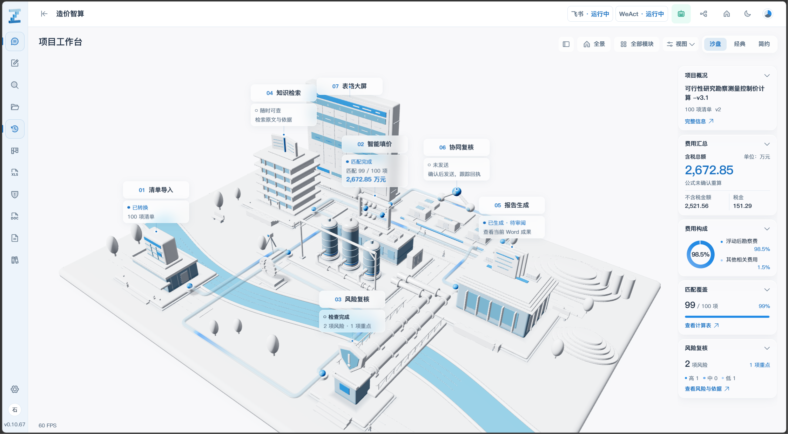
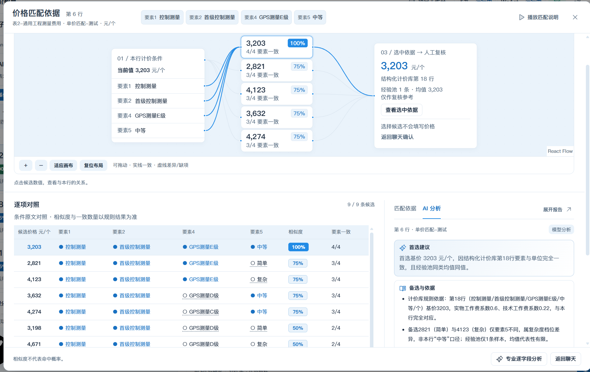
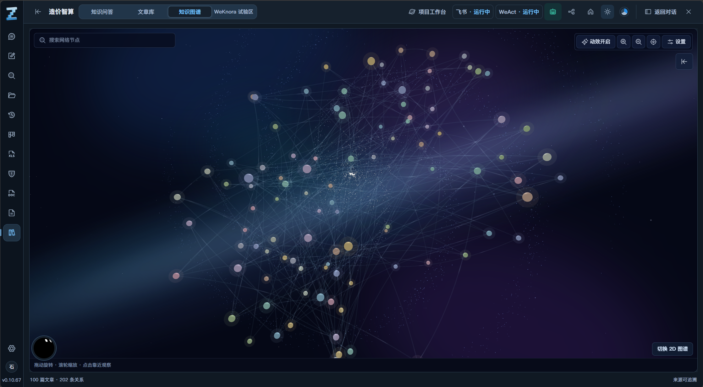

# 造价智算 · ZSuan

面向工程造价的对话式工作台，将清单识别、规则匹配、辅助填价、风险复核和成果导出串联在同一项目上下文中。Astra 是独立维护的工作台工程，以三维沙盘呈现任务阶段，保留专业表格与人工确认入口。

[功能介绍](#主要功能) · [界面与演示](#界面与演示) · [快速开始](#快速开始) · [项目文档](#项目文档) · [问题反馈](https://github.com/zgzzmnbx/zaojia-zhisuan-astra/issues)

> 当前开发分支为 [`codex/conveyor-integrated-white`](https://github.com/zgzzmnbx/zaojia-zhisuan-astra/tree/codex/conveyor-integrated-white)，前端版本 **v0.20.2**。`main` 保留独立的历史代码基线；请按下方命令选择开发分支。版本号表示源码状态，模型、Office、协同平台及 Watch 的实际验收范围见对应记录。

演示设置位于 **设置 → 演示与调试**：顶栏投影屏图标绿色表示开启。默认开启演示预设与沙盘停靠项目“德化-永安支线”，可修改展示包裹的简称、停靠站点或单独关闭；额外包裹沿用路人包裹外观，点击浅灰标签查看项目信息；“开启项目”按钮禁用，不建立真实业务项目。

更新后的演示回归：双击根目录 **运行演示回归测试.bat**，在独立副本中跑24项自动检查并生成报告；六项平台/设备/现场验收单独留证。详见 [完整测试流程](00-docs/10-比赛演示功能回归测试流程.md) 和 [测试工具说明](tools/demo-regression/README.md)。

## 界面与演示



<details>
<summary>查看更多界面截图</summary>

**表格与 AI 辅助填价**



**知识图谱**



</details>

截图为历史界面记录，当前外观以所选分支实际运行结果为准。

- [模块组装与灵动块演示 v1.2](https://github.com/zgzzmnbx/zaojia-zhisuan-astra/blob/main/06-汇报-演示-录屏-截图/01-项目截图和视频/造价智算-模块组装与灵动块-v1.2.mp4)
- [汇报 PPT 与演示资料](https://github.com/zgzzmnbx/zaojia-zhisuan-astra/tree/main/06-汇报-演示-录屏-截图/02-汇报PPT)

## 主要功能

- **协同复核流程**：在分配 / 查询对话卡中直接查看交互流程，并可放大到沙盘，配置平台、接收人、截止时间，并查看真实复核回执；可放大、拖动，避开两侧窗口。

| 能力 | 说明 |
| --- | --- |
| 对话与三维沙盘 | 用七座功能建筑及任务包裹展示当前阶段；沙盘、经典、简约等布局共享会话、草稿、任务和成果。 |
| 清单识别与规则匹配 | 导入 Excel，确认工作表、表头与字段映射，执行价格及系数匹配。 |
| 行级辅助填价 | 查看候选、来源、条件对照和模型分析，按当前成果版本逐字段确认写入。 |
| 费用与风险复核 | 展示费用汇总、偏离率与风险依据，定位到具体单元格，保留人工修改及公式重算状态。 |
| Excel / Word 成果 | 下载完整工作簿与报告，支持报告预览和公文格式处理。 |
| 知识问答与图谱 | 提供问题推荐、引用证据与二维 / 三维知识网络；可配置 WeKnora 接入。 |
| 项目看板与鸟瞰 | 查看项目统计、历史运行和已确认地点，以地图及地球视图浏览项目。 |
| 数字化造价模块 | 通过独立服务接入功能点识别、复核及费用计算；源码、依赖和业务数据保持隔离。 |
| 协同与 Gork | 支持飞书 / WeAct 选人复核及回执，通过已授权的本机控制台提供 Watch 提醒与语音交互。 |

价格、系数及报告遵循业务规则和人工复核流程。AI 推断写入前需要确认；三维动效展示任务状态，不能替代成果验收。

## 快速开始

### 环境要求

- **Windows 桌面环境**，使用支持 WebGL 的现代浏览器。
- Git、Node.js / npm、Python。本项目文档记录的验证环境为 **Node.js 24.14.1、Python 3.14.3**；依赖版本见锁文件。
- 本机 **5189** 端口可用；端口冲突时启动器会停止，请先核对占用服务。
- 自动公式重算需要 Microsoft Excel（COM）；旧式 `.doc` 处理需要 LibreOffice。字体需自行准备合法本机副本。

### 安装与启动

在 Windows PowerShell 中执行：

```powershell
git clone --branch codex/conveyor-integrated-white https://github.com/zgzzmnbx/zaojia-zhisuan-astra.git
cd zaojia-zhisuan-astra
npm ci
python -m venv .venv
.\.venv\Scripts\python.exe -m pip install -r requirements.txt
npm run build
npm start
```

打开 **[http://127.0.0.1:5189/](http://127.0.0.1:5189/)**。FastAPI 宿主同时提供界面与受控业务 API。

克隆仓库不会提供模型密钥、用户业务数据、已部署的数字化模块运行包或外部服务。首次运行的可用能力取决于本机依赖和配置；固定演示案例的触发条件及结果来源见[演示规则](https://github.com/zgzzmnbx/zaojia-zhisuan-astra/blob/codex/conveyor-integrated-white/演示项目预置规则说明.md)。

### 已部署环境

本项目现有正式部署使用根目录的 **`启动造价智算3-Astra.bat`**；`npm start` 复用同一套启动器。启动目标可由本机忽略配置 `config/astra-launch.local.json` 的 `workspace` 指定；没有配置时使用项目根目录。正式运行副本位于 `runtime/astra-service/`，回滚副本位于 `runtime/backups/`。

启动前可执行只读检查：

```powershell
powershell -NoProfile -File tools/launch-preview.ps1 -NoBrowser -CheckOnly
```

普通启动不自动安装依赖或构建。日志位于目标工作区的 `Codex-Temp/preview-*.log`，关闭浏览器不会结束后台宿主。发布与回滚请遵循[正式运行与发布保护](https://github.com/zgzzmnbx/zaojia-zhisuan-astra/blob/codex/conveyor-integrated-white/00-docs/09-正式运行与发布保护.md)。

## 使用流程

1. 创建或恢复对话，上传清单，核对项目、工作表、表头与字段映射。
2. 确认结构并转换，执行规则匹配，查看费用摘要和候选依据。
3. 对需要处理的字段逐行复核，确认辅助填价结果。
4. 检查风险并定位单元格，保留修改依据；需要核准公式金额时执行重算。
5. 预览并下载 Excel / Word 成果，按需处理公文格式或发起同事复核。

知识问答可从资料库进入，也可在聊天中使用 `#知识库：问题`。回答引用对应当次证据快照；上传项目资料不会自动改变计价规则。

## 配置与数据

模型、知识服务、协同和机器人连接从应用“设置”进入，凭据由宿主读取。

| 入口 | 用途 |
| --- | --- |
| [连接配置示例](config/astra-connections.example.json) | 模型与外部协同的配置结构、授权凭据文件引用。 |
| [WeKnora 配置示例](config/astra-weknora.example.json) | 独立知识服务地址与 Key 文件路径；本机配置使用 `.local.json`。 |
| [数字化模块说明](https://github.com/zgzzmnbx/zaojia-zhisuan-astra/blob/codex/conveyor-integrated-white/03-Src/modules/digital_cost/README.md) | 独立运行包、18768 端口、数据隔离与停用方式。 |

运行数据和私密配置不纳入 Git：包括 `runtime/`、本机 `.local.json`、密钥、虚拟环境和临时文件。冻结引擎中的部分业务数据位于 `03-Src/engine/Codex-Temp/runtime/`，实际路径以 `/api/health` 返回结果为准。**业务运行数据需要另行备份，Git 忽略不代表可以删除。**

## 技术栈与目录

- 前端：React 19、TypeScript、Vite 8、Tailwind CSS 4、daisyUI 5。
- 可视化：Three.js、Recharts、React Flow、3d-force-graph、MapLibre GL。
- 后端与文档：FastAPI、openpyxl、python-docx，以及版本化业务引擎和适配层。

```text
.
├── 00-docs/                 # PRD、来源、验收及交付记录
├── 03-Src/
│   ├── studio/              # 对话工作台、沙盘、看板与设置
│   ├── professional/        # 专业表格、风险与报告
│   ├── modules/             # 独立模块的宿主适配
│   ├── engine/              # 冻结业务引擎
│   └── vendor/              # 第三方与来源快照
├── 05-视觉识别/             # Logo、场景与模型资产
├── 06-汇报-演示-录屏-截图/  # 汇报与演示资料
├── config/                  # 配置示例与来源清单
├── public/                  # 静态资源与架构图
├── tests/                   # 前端与 Python 回归
└── tools/                   # 构建、启动和验证脚本
```

项目根目录是开发入口，`runtime/astra-service/` 用于正式运行，`04-output/` 为构建产物。数字化业务源码独立维护，Astra 负责入口、主题、网关及启动适配。

## 开发与验证

```powershell
npm test
npm run build
.\.venv\Scripts\python.exe -m pytest tests -q
.\.venv\Scripts\python.exe tools/verify_astra_v31.py
```

V3.1 验收需要对应输入及 Excel / Word 标准答案，结果写入独立副本。纯前端调试可使用 `npm run dev:frontend-debug`；它使用 5189 端口，不能与正式宿主同时运行，也不提供完整业务 API。

当前以 Windows 桌面为验收环境。表格预览保留前 50 行范围，完整数据通过下载获取；公式重算依赖 Excel。模型、知识服务、飞书 / WeAct 及 Watch 需要分别配置和验证。测试、构建、真实业务、Office 及设备验收分别记录，接口接通不代表全部验收完成。

## 项目文档

- [当前版本计划](https://github.com/zgzzmnbx/zaojia-zhisuan-astra/blob/codex/conveyor-integrated-white/00-docs/00-PRD/02-当前版本计划.md)：需求范围与验收口径。
- [功能保留与接入矩阵](https://github.com/zgzzmnbx/zaojia-zhisuan-astra/blob/codex/conveyor-integrated-white/00-docs/00-PRD/04-功能保留与接入矩阵.md)：原型、接口及业务验收状态。
- [DESIGN.md](DESIGN.md)：UI 设计标准。
- [交付与验收记录](https://github.com/zgzzmnbx/zaojia-zhisuan-astra/tree/codex/conveyor-integrated-white/00-docs/handoff)：各版本验证范围与回滚依据。
- [变更记录](https://github.com/zgzzmnbx/zaojia-zhisuan-astra/blob/codex/conveyor-integrated-white/CHANGELOG.md)与[历史归档](https://github.com/zgzzmnbx/zaojia-zhisuan-astra/blob/codex/conveyor-integrated-white/CHANGELOG-历史归档.md)。
- [改版前 README 维护记录](00-docs/README-维护记录-2026-11-09.md)：完整保留历史说明与更新记录。

## 参与与反馈

可通过 [GitHub Issues](https://github.com/zgzzmnbx/zaojia-zhisuan-astra/issues) 提交问题。请提供分支及版本、复现步骤、预期与实际结果，以及脱敏后的日志或截图。

提交改动前阅读 [AGENTS.md](AGENTS.md) 与 [DESIGN.md](DESIGN.md)，保留价格、系数、风险和报告语义，执行相关回归与交互验收。请勿提交密钥、私有业务数据和字体；单个超过 **50 MB** 的视频不纳入后续 GitHub 推送。

## 许可与来源

本仓库尚未声明统一的项目级开源许可证。公开可访问不代表全部代码、资料、字体及视觉资产获得再分发授权。

第三方组件遵循各自许可证；Gork 来源包含 AGPL-3.0-only。依赖与资产来源见 [THIRD_PARTY_NOTICES.md](THIRD_PARTY_NOTICES.md) 及各目录的 `SOURCE.md` / 许可证。迁移引擎的来源、版本与哈希见 `config/`、PRD 和验收记录，原始来源工程保持只读。
